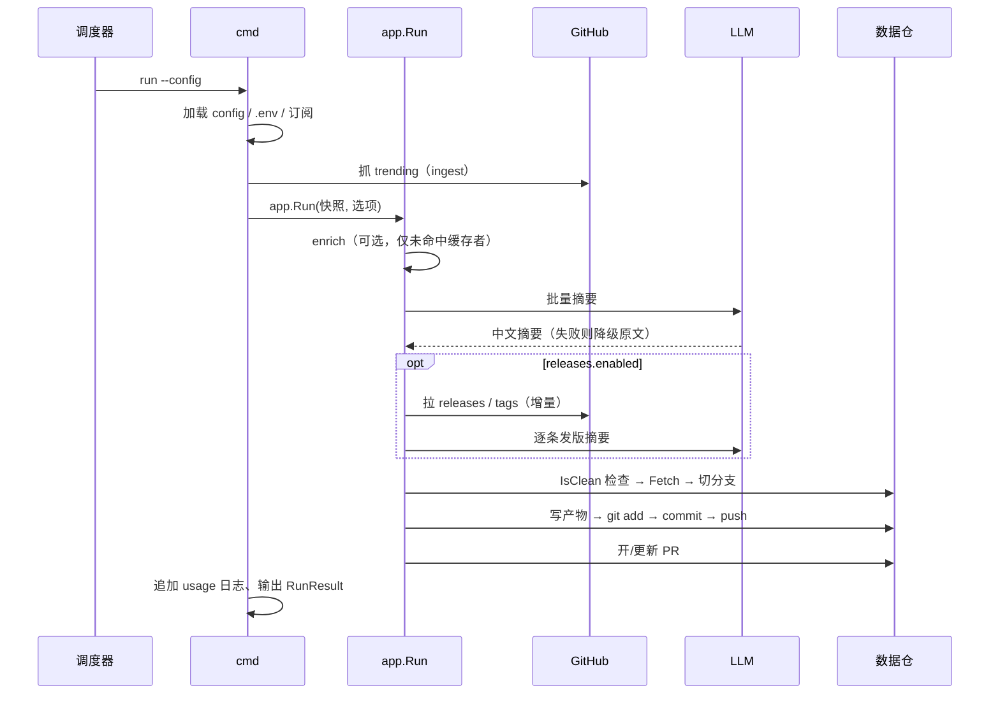

# trendradar 架构设计

> 状态：已批准 ｜ 作者：DSH Agent ｜ 评审人：morehao ｜ 拍板人：morehao ｜ 最后更新：2026-10-31

本文描述 trendradar 的**整体架构**：它解决什么问题、由哪些部件组成、数据如何流动、对外契约是什么、以及为什么这样切分。面向新加入的维护者与集成方（DSH 插件、Web 页面）。

具体到某次改动的设计，见 `docs/specs/` 下的专题方案；本文只讲「稳定的整体结构」。

**专题方案索引**

| 方案 | 状态 | 与本文的关系 |
|---|---|---|
| [仓库发版订阅（releases 阶段）](specs/2026-10-31-repo-release-watch-design.md) | 已实施（v0.5.0） | 新增 `releasewatch` 阶段与 `releases/` 产物（§2、§4） |
| [订阅能力纳入契约（contract v0.3.0）](specs/2026-10-31-contract-releases-v3-design.md) | 已实施 | `releases.v2.json` 与 serve 发版接口（§6） |
| [订阅数据版本化（方案 A）](specs/2026-10-31-subscription-repo-versioned-design.md) | 已批准，未实施 | 订阅从本机文件迁至数据仓（§5、§7、§9） |

---

## 1. 问题与定位

**要解决的问题**：个人/团队维护的开源项目分散在多个仓库，两类信息需要定期汇总、阅读、沉淀：

1. **发现**：今天 GitHub 上哪些项目在涨（trending 榜单）。
2. **跟踪**：我自己订阅的仓库，每次发版改了什么（Release / Tag）。

**做法**：一个 Go 单二进制，每日运行一次，抓取 → 用模型写中文摘要 → 渲染成 Markdown/JSON → 提交进一个「数据仓」并开 PR。人工合并后，数据仓成为可长期回溯的知识库。

**不做什么**：不是数据平台、不做实时推送、不托管订阅的 Web 管理界面（详见 §9）。

### 设计约束（决定了下面的所有取舍）

| 约束 | 影响 |
|---|---|
| 单二进制分发（goreleaser，多平台） | 不引入外部服务依赖；状态全部落本地文件 |
| 运行在无人值守的定时任务里 | 必须幂等、必须可重入、失败不能阻断另一阶段 |
| 结果要能被**人和机器**同时消费 | 产物同时出 Markdown 与 JSON；对外形状进契约 |
| 有外部消费者（插件、Web） | 对外数据必须单一真源、版本化、向后兼容 |
| 密钥不能进仓库 | 只从环境变量 / `.env` 读取 |

---

## 2. 系统全景

**一句话概括数据流**：外部数据 → 抓取/解析 → 摘要 → 渲染 → git 提交/PR → 数据仓 → 人读 / HTTP 读。

---

## 3. 部件与职责

代码规模约 7.2k 行实现 + 3.8k 行测试，按职责分包：

| 包 | 职责 | 关键约束 |
|---|---|---|
| `cmd/trendradar` | CLI 入口、子命令接线、`--json` 信封输出 | 不做业务逻辑，只做参数解析与结果映射 |
| `internal/app` | **编排**：摘要 → 渲染 → commit/push → PR，含 releases 阶段接入 | 唯一知道完整流水线的地方 |
| `internal/config` | config.yaml 加载、默认值、校验、`${VAR}` 展开 | **不联网、不写文件**，启动期安全 |
| `internal/ingest` | fetch + parse 的组合，含 HTML→search 兜底 | 只产出快照，不摘要 |
| `internal/fetch` | GitHub HTTP：trending HTML、search API、releases/tags/commit 分页 | 统一经 ghttp（重试/限流/大小上限） |
| `internal/parse` | HTML 解析为仓库快照 | 容错优先，缺字段不导致整体失败 |
| `internal/summarize` | 榜单摘要：prompt、批量、缓存、输出校验与修复 | 单批失败只降级本批 |
| `internal/enrich` | 可选外部上下文：topics / README 摘录 | best-effort，失败逐仓降级 |
| `internal/releasewatch` | 发版订阅：增量判定、摘要、游标状态 | 按仓库粒度推进游标 |
| `internal/releasedigest` | 发版文档类型（contract 别名）+ 内容哈希 | 类型不重复定义 |
| `internal/digest` | 榜单领域类型（contract 别名） | 同上 |
| `internal/render` | 产物渲染（md/json/index）、路径规则、稳定哈希 | `output.dir` 是路径唯一真源 |
| `internal/gitx` | 包 `git` 二进制：fetch/切分支/add/commit/push/rebase | **不经 shell、token 不进 argv** |
| `internal/pr` | GitHub PR 最小客户端（REST） | token 调用时注入，不落盘 |
| `internal/serve` | 只读 HTTP：榜单 / 发版 / 订阅 | 无鉴权，仅本机监听 |
| `internal/ipc` | 信封、错误码、版本信息的 Go 侧别名 | 与 contract 同源 |
| `internal/subscription` | 订阅列表读写、校验、原子写 | 路径解析规则唯一 |
| `internal/envfile` | `.env` 加载 | 真实环境变量优先 |
| `internal/model` | LLM Provider 抽象（gllm / fake） | 可离线跑全流程 |
| `contract/` | **对外形状唯一真源**：7 份 schema + 生成的 Go/TS 类型 | 独立 Go module + npm 包 |

---

## 4. 运行时视图：一次 `run`

阶段与可观测：`stages` 记录 `enrich` / `summarize` / `releases` / `git` 的耗时；`usage` 记录 token；两者都进 `run --json` 与 `trendradar-usage.jsonl`。

**三条不变量**（改动时必须保持）：

1. **幂等**：同一输入重复运行不产生新提交（`render.Comparable` + 内容哈希 + `filesMatch`）。
2. **阶段隔离**：某阶段失败/未启用 → 完全旁路，不影响另一阶段的产物字节。
3. **游标后置**：发版游标只在发布成功后才推进；失败保留旧游标。

---

## 5. 数据与存储

| 数据 | 位置 | 入库 | 生命周期 |
|---|---|---|---|
| 榜单产物 | `<repo>/<output.dir>/{index.md,<period>/<bucket>/<name>.{md,json}}` | 是 | 长期保留；索引只列最近 N 期（见下） |
| 发版产物 | `<repo>/<output.dir>/releases/...` + `subscriptions.yaml` | 是 | 同上 |
| 摘要缓存 | `<repo>/.git/trendradar-cache.json` | 否 | 30 天 TTL |
| 发版游标 | `<repo>/.git/trendradar-release-state.json` | 否 | 随发版推进 |
| 用量日志 | `<repo>/.git/trendradar-usage.jsonl` | 否 | 追加，按行消费 |

**路径规则**（`internal/render`）：

- `OutputRoot(dir)`：归一 `output.dir`；空/`.`/绝对/`..` 一律回落 `digests`。
- `BucketOf(period, date)`：daily→`YYYY-MM`，monthly→`YYYY`，weekly→ISO 年。
- `NameOf(period, date)`：daily→`YYYY-MM-DD`，monthly→`YYYY-MM`，weekly→`YYYY-Www`。
- 分支名：`<branchPrefix><period>/<name>`。

索引收敛：`index.md` 每个周期只列最近 N 期，N 在 `internal/app/run.go` 中固定为
daily=90 / weekly=12 / monthly=12。配置文件里的 `output.retentionDays` 目前**仅被解析、未参与任何逻辑**，属既有技术债（见 §9）；不要据此认为文件会被自动删除。

这三条是写入与读取的**唯一真源**，`run` 与 `serve` 都必须复用，不允许各自拼路径。

---

## 6. 对外契约

**为什么有契约**：内核（Go）与插件（TS）必须对同一份数据形状达成一致，且插件升级不应阻塞内核。契约把形状从代码里抽出来，一次定义、两端生成。

**7 份 schema**

| schema | 内容 | wire 版本载体 |
|---|---|---|
| `model.v2.json` | `RepoSnapshot` / `RepoDigest` | 经 digestSchema 传递 |
| `digest.v2.json` | 榜单文档 | `digestSchema` (2) |
| `releases.v2.json` | 发版文档 + 运行报告 + 订阅列表 | 无独立 wire key |
| `ipc.v2.json` | `RunRequest`（严格）/ `RunResult` / `Usage` / `State` | `ipcSchema` (2) |
| `errors.v2.json` | 17 个错误码 + 可重试标记 | — |
| `version-info.v2.json` | 握手 | `contractVersion` |
| `api.v2.yaml` | serve 的 OpenAPI | `info.version` |

**三条契约规则**（违反即破坏外部消费者）：

1. **别名而非复制**：内核用 `type X = contract.X`，禁止在 `internal/` 重复定义。
2. **wire 整数与包版本解耦**：新增可选字段只升包版本；提升 `ipcSchema` 会强制所有插件升级。
3. **零值必须可区分**：成本/计数这类字段，`0` 与「缺失」语义不同时不用 `omitempty`。

**入口面**

| 入口 | 消费者 | 说明 |
|---|---|---|
| `run --json` | 插件 | 输出 `RunResult`（`files`/`branch`/`prUrl`/`usage`/`releases`…） |
| `subscribe --json`（stdin） | 插件 | 读 `RunRequest`，管理订阅 |
| `serve` HTTP | 插件、Web | 见下 |
| 数据仓产物 | 人、脚本 | Markdown 供阅读，JSON 供解析 |

**serve 只读接口**：`/api/v2/digests/{date}`、`/api/v2/digests/{period}/{date}`、`/api/v2/manifest`、`/api/v2/releases`、`/api/v2/releases/{date}`、`/api/v2/subscriptions`、`/feed.xml`。

---

## 7. 关键设计决策与选型对比

每个决策都给出「选择 / 备选 / 否决理由」，理由是回指约束的（见 §1）。

| 决策 | 选择 | 备选方案与否决理由 |
|---|---|---|
| 分发形态 | 单 Go 二进制 | 多二进制/服务化 → 部署成本高，定时任务场景不需要 |
| 产物形态 | Markdown + JSON 双份 | 只 JSON → 人不可读；只 MD → 机器难解析 |
| 摘要时点 | 写入时摘要，结果落盘 | 读取时摘要 → 每次读都花钱、结果不稳定 |
| 摘要缓存 | 按 provider/model/prompt/enrich 命名空间 | 不缓存 → 重跑文本漂移、成本翻倍 |
| 落盘与提交 | 写数据仓 + PR，人工合并 | 直接推 main → 破坏受保护分支；只写本地 → 无沉淀 |
| 发版增量 | 本地游标（id/publishedAt/seenTags） | 全量重扫 → 重复摘要、成本高 |
| 外部形状 | 独立 contract 包，双端生成 | 各写一份 → 漂移（已发生过） |
| 订阅存储 | 数据仓内文件（[方案 A](specs/2026-10-31-subscription-repo-versioned-design.md)，已批准未实施） | 本机文件 → 换机失忆、不可审计 |

每个决策的详细权衡见上表列出的专题方案。

---

## 8. 质量属性

| 属性 | 现状 | 机制 |
|---|---|---|
| **幂等** | 同内容不产生新提交 | `render.Comparable` 排除 `generatedAt` + 内容哈希 + `filesMatch` |
| **容错** | 单仓库/单批失败不阻断整体 | 逐批降级、逐仓降级、游标按仓推进 |
| **可观测** | 每阶段耗时 + token + 降级计数 | `stages` / `usage` / `--json` / usage 日志 |
| **成本可控** | 缓存 + 增量 + 预算 | 摘要缓存、游标增量、`budgetSeconds` 阶段预算 |
| **可测试** | 3.8k 行测试，可离线全流程 | `model.Fake` provider + httptest + 临时 git 仓 |
| **限流友好** | 认证 5000 req/h | `GITHUB_READ_TOKEN`；未认证 60 req/h 兜底 |

---

## 9. 边界与已知限制

- **平台**：仅 GitHub；GitLab/Gitee、私有仓库鉴权未覆盖。
- **粒度**：到 Release/Tag，不做 commit 级 diff。
- **时效**：定时轮询，延迟 ≤ 1 个调度周期；无 webhook。
- **serve**：只读、无鉴权，仅适合本机/内网。
- **订阅存储**：当前为本机文件；[订阅数据版本化方案](specs/2026-10-31-subscription-repo-versioned-design.md) 已评审通过、尚未实施。
- **契约历史债**：`stages` / `enrich` 两个字段仍在 `additionalProperties` 兜底下，未进 schema。
- **未生效的配置项**：`output.retentionDays` 仅解析不生效，索引条数实际由代码内常量决定（daily 90 / weekly 12 / monthly 12）。

---

## 10. 如何扩展

| 想做的事 | 从哪下手 | 注意 |
|---|---|---|
| 加一个新的数据源 | `internal/fetch` + 新 `internal/<source>` + `app.Run` 接入 | 先确认是否要进契约（参照 [contract v0.3.0 方案](specs/2026-10-31-contract-releases-v3-design.md)） |
| 改产物格式 | `internal/render` | 同时改 `digest.v2.json` 与测试；`Comparable` 要跟着调 |
| 加对外字段 | `contract/schema` → `npm run generate` → 内核别名 | 走 §6 三条规则，禁止绕过契约 |
| 加一个 CLI 子命令 | `cmd/trendradar` + 复用现有包 | 若对外可见，`RunRequest`/`RunResult` 要同步 |
| 加一个 serve 接口 | `internal/serve` + `api.v2.yaml` | 保持只读；结构变更视为契约变更 |

---

## 附录：术语

| 术语 | 含义 |
|---|---|
| 榜单 / digest | trending 抓取生成的一期摘要文档 |
| 发版 / releases | 订阅仓库的 Release/Tag 摘要文档 |
| 数据仓 | `run` 写入的目标 git 仓库，产物与订阅在此沉淀 |
| 游标 / cursor | 记录「某仓库已处理到哪个版本」的本地状态 |
| 契约 / contract | 对外的数据形状定义，Go 与 TS 双端生成 |
| 阶段 / stage | `run` 的一个可计时步骤（enrich/summarize/releases/git） |
