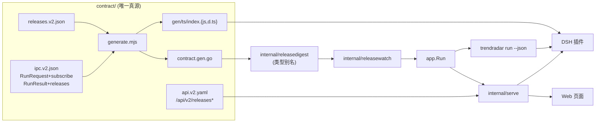
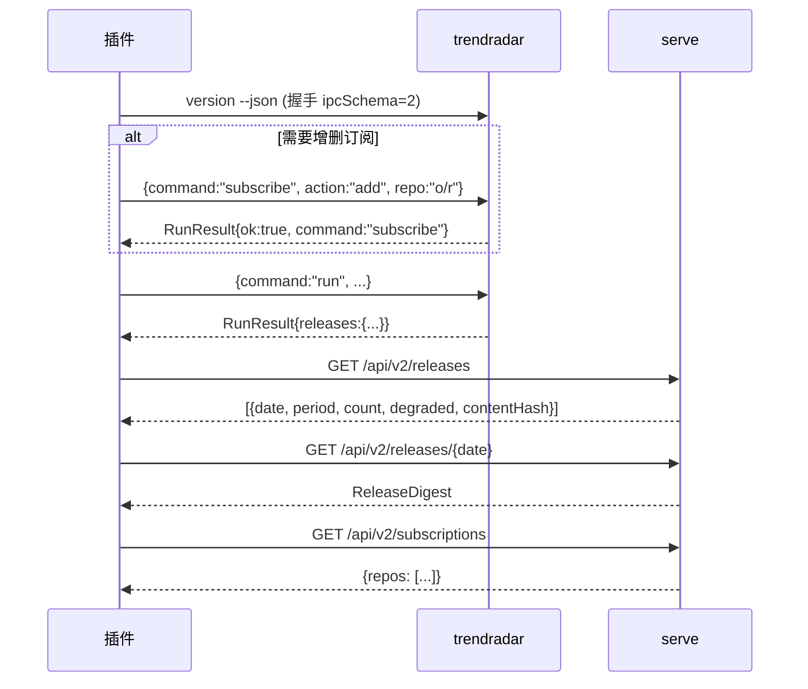
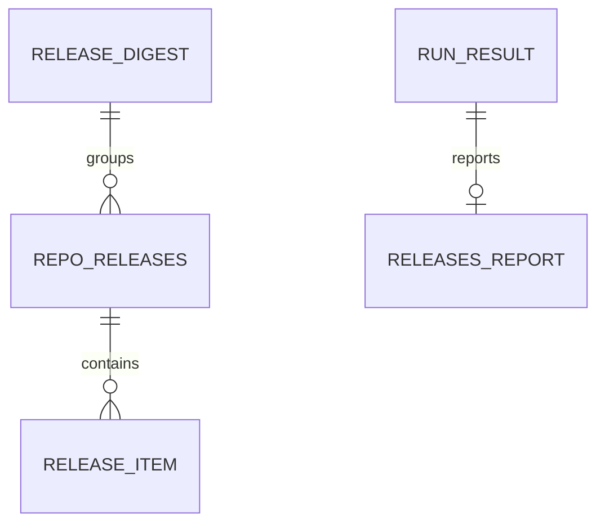

# 订阅能力纳入契约与对外消费接口技术方案（contract v0.3.0）

> 状态：已批准 ｜ 实施：已落地（`contract 0.3.0`）｜ 作者：DSH Agent ｜ 评审人：morehao ｜ 拍板人：morehao ｜ 最后更新：2026-10-31

> 落点：C（既有系统的既有模块）。主场景：S2 增量改造（含 S4 的版本载体迁移义务）。档位：标准档。用途：构建契约。
> 相关：整体架构与契约规则见 [architecture.md](../architecture.md)；本方案是其 §6 的落地；订阅存储演进见 [订阅版本化方案](2026-10-31-subscription-repo-versioned-design.md)。
>
> 一句话：把 `v0.5.0` 里只在内核内部使用的发版订阅数据形状提升为 contract 的正式类型（新增 `releases.v2.json`），把 `subscribe` 纳入 `RunRequest`、把 `releases` 报告块显式纳入 `RunResult`，并在 `serve` 增加发版列表/详情/订阅列表三个只读接口，最终发布 `contract/v0.3.0`。

## 背景与目标

### 业务背景与现状

`v0.5.0`（PR #23，tag `v0.5.0`）新增了仓库发版订阅：订阅列表在 `subscriptions.yaml`，`run` 的 `releases` 阶段把结果写到 `<output.dir>/releases/`。但这些能力**只对内核内部可见**：

| 事实 | 证据锚点 |
|---|---|
| contract 包只覆盖 trending 与 IPC 信封，无发版类型 | `contract/schema/` 仅 `api.v2.yaml`、`digest.v2.json`、`errors.v2.json`、`ipc.v2.json`、`model.v2.json`、`version-info.v2.json` |
| 发版文档类型定义在 internal 包，npm 包与插件均不可见 | `internal/releasedigest/releasedigest.go`（`ReleaseDigest` / `RepoReleases` / `ReleaseItem`） |
| `RunRequest` 是严格模式，`command` 只有四个值 | `contract/schema/ipc.v2.json` 的 `RunRequest.additionalProperties: false`、`command.enum: [run, serve, config, version]` |
| `RunResult` 允许附加字段，发版报告靠这条口子挂上去 | `ipc.v2.json` 的 `RunResult.additionalProperties: true`；`cmd/trendradar/run.go` 的 `runEnvelope.Releases` |
| `serve` 现有路由只有榜单相关 | `internal/serve/server.go:23-35`（`/api/v2/digests/*`、`/api/v2/manifest`、`/feed.xml`） |
| `serve` 已依赖 contract，可复用其类型 | `internal/serve/store.go:9-14`（import contract）与 `Digest()` 返回 `*contract.Digest` |
| 严格性有测试锁定，改 schema 必须同步改测试 | `contract/test/contract.test.mjs:42-46` |
| 契约版本号有多处硬断言 | `contract/test/contract.test.mjs:18`、`contract/scripts/check-versions.mjs`、`contract/version-map.json` |

**需求来源**：用户明确「订阅要有外部消费者——DSH 插件和未来可能的 Web 页面」，并已拍板三件事：发 `contract/v0.3.0` 一次性补齐；`subscribe` 进 IPC；serve 提供「列表 + 单日详情 + 订阅列表」。

### 痛点分析

1. **插件拿不到类型**：插件（`@morehao/dsh-github-trending`）若要在界面展示「今天发了几个版本、哪个仓库最活跃」，只能手写类型，与内核实现容易漂移。
2. **`releases` 报告块是「法外之地」**：借 `RunResult.additionalProperties: true` 挂上去，缺 schema 校验；字段改名不会在契约测试里暴露。同类问题已在 `stages`/`enrich` 上存在。
3. **插件不能管理订阅**：`subscribe` 只能通过 CLI 二进制参数调用，插件必须依赖命令行的具体参数约定，脆弱。
4. **Web 无数据来源**：`serve` 不提供发版数据，未来页面只能直读文件系统或自己拼。

### 目标与非目标

**业务目标**：发版订阅成为**一等契约能力**——插件与 Web 页面能拿到稳定类型与只读接口，不需要读内核实现细节或手写重复定义。

**技术目标（可衡量）**：

- G1 类型唯一真源：`ReleaseDigest` 等在代码库内只有 **1 处**定义（contract），`internal/releasedigest` 改为别名或删除；口径：`grep -rn "type ReleaseDigest"` 结果为 1。
- G2 契约校验覆盖：`RunResult.releases` 与 `RunRequest.subscribe` 都有 ajv 校验用例；口径：`contract/test/contract.test.mjs` 新增用例 ≥ 4 条且全绿。
- G3 三端一致：Go 结构、TS 类型、OpenAPI 三处对同一字段的描述一致；口径：`npm run verify`（生成后 `git diff --exit-code`）通过，`make verify-versions` 通过。
- G4 兼容性：未启用订阅的部署，`run` 行为与 `v0.5.0` 一致（`releases.enabled=false` 时 `RunResult` 不含 `releases` 块，trending 产物不变）。
- G5 Web 可用：`serve` 新增 3 个只读接口，均有 OpenAPI 描述与 httptest 用例。
- G6 成本可见：`releases` 报告块以结构化 `usage` 暴露 token 消耗，且 `usage` 恒存在（不因 0 值消失）；口径：`usageKnown=false` 时计数为 0，`usageKnown=true` 时 `totalTokens>0`。

**收益口径**：插件侧可删掉的重复类型定义预计 3 个结构（`ReleaseDigest`/`RepoReleases`/`ReleaseItem`），按每个 20 行估算约 60 行重复代码；Web 页面从「直读文件系统」改为「调 1 个 HTTP 接口」，接入成本从「需要文件系统权限」降为「一次 HTTP 请求」（假设：Web 与数据仓不在同一机器）。

**非目标（超出范畴的用例）**：

- 不把 `stages`/`enrich` 一并纳入契约——它们同属技术债，但不在本次订阅诉求内，单独立项。
- 不做订阅的写接口（`POST /api/v2/subscriptions`）——本期 serve 仍为只读；原因是写接口要引入鉴权，属于新的安全问题。
- 不做发版数据的 RSS/推送——本期只做 JSON 接口。
- 不改 `digest.v2.json`、`model.v2.json`、`errors.v2.json`：发版数据不复用 trending 的 `RepoSnapshot`（无版本概念），错误码沿用既有 17 个。

**反目标（做成了也算失败）**：

- 若为了兼容插件而在契约里保留两套发版定义（internal 一份 + contract 一份）——即使功能正确也算失败。
- 若 `RunRequest` 放宽为非严格模式来「先跑通」——即使校验通过也算失败（严格性是契约的价值所在）。
- 若新增接口让现有 `/api/v2/*` 的响应结构发生变化——即使新接口可用也算失败。

### 假设与约束

- `[假设]` **wire 版本保持 2**：`releases.v2.json` 沿用 `v2` 命名与 `ipcSchema=2`/`digestSchema=2` 不变；新增 schema 属于**同一代线格式的扩展**，只提升包版本（`0.2.0 → 0.3.0`），不提升 wire 整数。理由是插件按 `ipcSchema===2` 做握手，提升它会强制所有插件升级。
- `[假设]` **发版文档带独立 schema 版本**：`ReleaseDigest.schema` 固定为 `1`（沿用 v0.5.0 已落盘的数据），不随 contract 版本变化。
- `[假设]` **serve 默认同时暴露榜单与发版**：不新增开关；无发版数据时返回空列表而非 404（口径见接口设计）。
- 硬约束：Go 1.26.1；`contract/` 是独立 Go module + npm 包，版本载体在 `version-map.json`；tag 形如 `contract/v0.Y.Z`。
- 兼容约束：`@morehao/dsh-github-trending` 当前依赖 `contract` 的 `0.2.x`；本次发布后需升级依赖以使用新能力，旧版本插件仍可工作（新增字段均为可选）。

### 验收标准

| 目标 | 验证方式 | 阈值 | 谁验 |
|---|---|---|---|
| G1 单一真源 | `grep -rn "type ReleaseDigest"` 全仓 | 恰好 1 处（contract.gen.go） | 开发者 |
| G2 契约校验 | `cd contract && npm test` | 新增 ≥4 用例，全绿 | 开发者 |
| G3 三端一致 | `npm run verify` + `make verify-versions` | 两条均 exit 0 | 开发者 |
| G4 兼容性 | 关闭订阅跑 `run`，比对 `RunResult` 与 v0.5.0 | 无 `releases` 字段，trending 产物 `Comparable` 一致 | 开发者 |
| G5 Web 可用 | `go test ./internal/serve` + 手工 curl | 3 个接口各有用例，返回结构符合 OpenAPI | 开发者 |
| G6 成本可见 | 跑启用/停用订阅各一次，检查 `run --json` 的 `releases.usage` | 停用时 `usage` 仍存在且各计数为 0；启用且模型返回 usage 时 `totalTokens>0`、`usageKnown=true` | 开发者 |

## 方案设计

### 系统上下文与边界

- **本系统**：`contract/`（schema + 代码生成 + 版本载体）、`internal/releasedigest`（改为别名或移除）、`internal/serve`（新增路由）、`cmd/trendradar`（`subscribe` 的 IPC 入口）。
- **上游消费者**：DSH 插件（`@morehao/dsh-github-trending`）、未来 Web 页面（经 `serve`）。
- **下游依赖**：无新增外部依赖；沿用 ajv（校验）、canonicalize（JCS）、既有 `ghttps`。
- **边界与数据所有权**：contract 拥有**形状**；内核拥有**数据生成**；serve 只读；插件只读（订阅写仍走 CLI 或 IPC `subscribe` 命令）。
- **对既有模块的影响**：`digest.v2.json` 等 5 个既有 schema 不变；`/api/v2/*` 既有路由响应不变；`contract` 包版本号提升，`internal/ipc/version.go` 的 `ContractVersion` 需同步为 `0.3.0`。

### 总体思路

新增一份 `releases.v2.json` 承载发版文档，其余改动都围绕它展开：

- **Go 侧**：代码生成产出 `contract.ReleaseDigest` 等类型；`internal/releasedigest` 的类型改为对 contract 的别名（与 `internal/digest` 对 `contract` 的做法一致），内核逻辑零改动。
- **IPC 侧**：`RunRequest.command` 增加 `subscribe` 并新增 `action`/`repo` 字段（仍严格）；`RunResult` 增加显式 `releases` 定义（保留 `additionalProperties: true` 以免破坏既有 `stages`/`enrich`）。
- **HTTP 侧**：`serve` 新增 `/api/v2/releases`、`/api/v2/releases/{date}`、`/api/v2/subscriptions`，OpenAPI 补全。

### 总体架构



图中要点：contract 是唯一形状来源，Go/TS 由同一份 schema 生成；插件既能读 `run --json`（本地二进制）也能读 `serve`（HTTP），两条路共用同一 TS 类型。

### 核心流程



### 备选方案与取舍

| 备选 | 做法 | 优点 | 代价 / 不选原因 |
|---|---|---|---|
| **A（选中）新增 releases.v2.json 全文** | 发版文档独立 schema，三端生成 | 单一真源；契约外字段收敛为契约内 | 需要扩 `RunRequest`，发布新的 contract 版本，插件升级 |
| B 仅扩 `RunResult.releases`，不新增独立 schema | 把发版类型塞进 `ipc.v2.json` 的 `$defs` | 少一个 schema 文件 | 发版文档是「数据文档」不是「信封」，与 digest 并列更合理；`ipc.v2.json` 会膨胀 |
| C 只加 serve 接口，不进契约 | HTTP 用 inline schema 描述 | 插件无感、零 breaking | Web 与插件两套定义，正是当前问题的放大版；插件仍拿不到类型 |
| D 维持现状（v0.5.0 做法） | 继续用 `additionalProperties` 口子 | 零改动 | 用户已明确要有外部消费者，类型漂移风险不可接受 |

选择 A 的判据：G1（单一真源）与 G3（三端一致）都要求同一份定义被三端复用，只有把发版文档做成与 `digest.v2.json` 平级的 schema 才能满足；B 的代价是把不同性质的文档混进信封 schema。

### 技术选型与理由

- **wire 整数保持 2、只升包版本**（选中）。Why：插件以 `ipcSchema===2` 做握手，提升整数会让所有旧插件拒绝工作；本次新增字段全部可选，属于向后兼容扩展。代价：包版本与 wire 版本不完全对应，需要在 `version-map.json` 与文档里写清楚。何时不该选：若将来把某个必填字段的语义改掉，才提升 wire 整数。
- **`internal/releasedigest` 保留为别名**（选中）。Why：内核多处引用该类型，删除会牵连 `releasewatch`/`render`/`app`；别名与 `internal/digest` 对 contract 的做法完全一致（`internal/digest/types.go:18-22`）。代价：多一层间接。何时不该选：若未来 contract 类型不满足内核需要（如需要非导出字段）。
- **`subscribe` 走 IPC 但保持严格模式**（选中）。Why：插件不必依赖 CLI 参数约定；`action`/`repo` 显式声明后严格校验仍成立。代价：`RunRequest` 字段增加，插件需升级类型。何时不该选：若订阅写入需要复杂交互（如批量导入），IPC 单命令不合适。
- **serve 只读、无鉴权**（选中）。Why：与现有 `/api/v2/*` 一致，仅本机监听（`127.0.0.1:8787`）。代价：不能远程管理。何时不该选：若要把 serve 暴露到公网，必须先加鉴权（列入已知未覆盖）。

### 决策与需求对照

| 决策 ID | 决策 | 承接需求 | 备选（含不做） | 验证手段 | 状态 |
|---|---|---|---|---|---|
| E1 | 新增 `releases.v2.json`，含 `ReleaseDigest`/`RepoReleases`/`ReleaseItem` | R1 | 塞进 ipc.v2.json / 只加 HTTP / 维持现状 | contract 校验用例 | Proposed |
| E2 | `RunRequest.command` 增 `subscribe`，新增 `action`/`repo` | R2 | 仅 CLI / 放宽严格模式 | `runRequest` 校验用例（含额外字段被拒） | Proposed |
| E3 | `RunResult` 显式加 `releases` 定义 | R3 | 继续靠 additionalProperties | `runResult` 校验用例 | Proposed |
| E4 | serve 增 `/api/v2/releases`、`/{date}`、`/subscriptions` | R4 | 不做 / 只做详情 | httptest + OpenAPI | Proposed |
| E5 | 包版本 0.2.0 → 0.3.0，wire 整数保持 2 | R5 | 提升 wire 整数 / 不升版本 | `make verify-versions` | Proposed |
| E6 | `internal/releasedigest` 改为 contract 别名 | R1 | 保留双定义 | `grep` 唯一性 + 全量测试 | Proposed |
| E7 | `ReleasesReport.usage` 用结构化 `contract.Usage`，恒存在 | R6 | 维持 5 个 omitempty 扁平字段 / 不暴露 token | 停用/启用两种状态的 JSON 断言 | Proposed |

> 需求编号：R1 发版文档有唯一契约定义；R2 插件可通过 IPC 增删查订阅；R3 发版报告进契约；R4 Web 可读发版数据与订阅列表；R5 版本载体自洽且向后兼容；**R6 发版摘要的 token 消耗对消费端可见且可区分「零消耗」与「未上报」**。

## 详细设计

### 模块划分与职责

| 模块 | 新增/改动 | 职责 |
|---|---|---|
| `contract/schema/releases.v2.json` | 新增 | 发版文档、仓库分组、条目 |
| `contract/schema/ipc.v2.json` | 改 | `RunRequest` 增 `subscribe`/`action`/`repo`；`RunResult` 增 `releases` |
| `contract/schema/api.v2.yaml` | 改 | 3 个新路径 + 订阅列表响应 |
| `contract/schema/version-info.v2.json` | 不改 | 握手保持 `ipcSchema=2` |
| `contract/scripts/generate.mjs` | 改 | 注册 `releases.v2.json`，产出 `ReleaseDigest` 等类型与 `releases` 校验器 |
| `contract/version-map.json`、`package.json` | 改 | `0.2.0 → 0.3.0` |
| `contract/fixtures/release-*.json` | 新增 | 正常 / 降级 / 空三个 fixture |
| `internal/releasedigest` | 改 | 类型改为 contract 别名，保留 `ContentHash` |
| `internal/serve` | 改 | 3 个 handler + Store 读发版目录 |
| `internal/app/report.go` | 改 | `ReleaseReport` 的 5 个扁平 token 字段改为 `Usage *contract.Usage` |
| `internal/ipc/version.go` | 改 | `ContractVersion = "0.3.0"` |
| `cmd/trendradar` | 改 | `subscribe` 的 IPC 分支（复用现有子命令逻辑） |

### 接口设计

**契约：`releases.v2.json`**

```json
{
  "$id": "https://github.com/morehao/trendradar/contract/schema/releases.v2.json",
  "title": "trendradar releases v2",
  "required": ["schema", "date", "period", "contentHash", "contentHashAlgo", "count", "degraded", "repos"],
  "properties": {
    "schema": { "const": 1 },
    "date": { "type": "string", "format": "date" },
    "period": { "type": "string", "enum": ["daily", "weekly", "monthly"] },
    "contentHash": { "type": "string", "pattern": "^sha256:[0-9a-f]{64}$" },
    "contentHashAlgo": { "type": "string", "enum": ["jcs-sha256-v1"] },
    "coreVersion": { "type": "string" },
    "generatedAt": { "type": "string", "format": "date-time" },
    "count": { "type": "integer", "minimum": 0 },
    "degraded": { "type": "boolean" },
    "repos": { "type": "array", "items": { "$ref": "#/$defs/RepoReleases" } }
  },
  "$defs": {
    "ReleaseItem": {
      "required": ["tag", "kind", "summaryZh", "summarySource"],
      "properties": {
        "id": { "type": "integer", "minimum": 0 },
        "tag": { "type": "string" },
        "name": { "type": "string" },
        "kind": { "type": "string", "enum": ["release", "tag"] },
        "publishedAt": { "type": "string", "format": "date-time" },
        "url": { "type": "string", "format": "uri" },
        "prerelease": { "type": "boolean" },
        "draft": { "type": "boolean" },
        "bodyExcerpt": { "type": "string" },
        "summaryZh": { "type": "string" },
        "summarySource": { "type": "string", "enum": ["model", "original"] }
      }
    },
    "RepoReleases": {
      "required": ["fullName", "url", "latestTag", "newCount", "releases"],
      "properties": {
        "fullName": { "type": "string", "pattern": "^[^/]+/[^/]+$" },
        "url": { "type": "string", "format": "uri" },
        "latestTag": { "type": "string" },
        "newCount": { "type": "integer", "minimum": 0 },
        "releases": { "type": "array", "items": { "$ref": "#/$defs/ReleaseItem" } }
      }
    }
  }
}
```

**契约：`RunRequest` 增量**

```json
"command": { "type": "string", "enum": ["run", "serve", "config", "version", "subscribe"] },
"action": { "type": "string", "enum": ["list", "add", "remove"] },
"repo": { "type": "string", "pattern": "^[A-Za-z0-9_.-]+/[A-Za-z0-9_.-]+$" }
```

约束：`additionalProperties` 保持 `false`；`action`/`repo` 为可选字段，但 `command==="subscribe"` 时由内核校验（`list` 不需要 `repo`，`add`/`remove` 需要）——schema 层用 `allOf/if-then` 表达，避免把校验推到运行时。

**契约：`RunResult` 增量**

```json
"releases": { "$ref": "releases.v2.json#/$defs/ReleasesReport" }
```

其中 `ReleasesReport` 是**运行报告**（不是发版文档），字段与 `internal/app/report.go` 的 `ReleaseReport` 一一对应：

| 分组 | 字段 |
|---|---|
| 开关与规模 | `enabled`、`repos` |
| 结果计数 | `newReleases`、`summarized`、`degraded`、`failed`、`rateLimited`、`skipped`、`truncated`、`historyTruncated` |
| 耗时 | `durationMs` |
| **成本** | `usage`（见下） |

> 命名区分：`releases.v2.json` 里 `ReleaseDigest` 是**落盘文档**，`ReleasesReport` 是 **run 的报告**。两者含义不同，不能混用。

**成本（token）必须是一等字段**

当前实现（`v0.5.0`）把 token 用量拆成 5 个带 `omitempty` 的扁平字段（`internal/app/report.go:55-59`），有一个已实测的缺陷：

```
json.Marshal(ReleaseReport{})  ->  {}
```

全 0 时整个结构体序列化为 `{}`，消费端看到的是「字段不存在」而不是「消耗为 0」。后果：**无法区分「这次没花 token」与「内核没上报 token」**，而这两者对成本归因的意义完全不同（前者是缓存命中，后者是统计缺陷）。

因此改为与 trending 一致的结构化块，并复用既有 `contract.Usage` 定义（`ipc.v2.json` 的 `Usage`，已被 trending 使用，`internal/app/run.go:168`）：

```json
"ReleasesReport": {
  "required": ["enabled", "repos", "newReleases", "durationMs", "usage"],
  "properties": {
    "enabled": { "type": "boolean" },
    "repos": { "type": "integer", "minimum": 0 },
    "newReleases": { "type": "integer", "minimum": 0 },
    "summarized": { "type": "integer", "minimum": 0 },
    "degraded": { "type": "integer", "minimum": 0 },
    "failed": { "type": "integer", "minimum": 0 },
    "rateLimited": { "type": "integer", "minimum": 0 },
    "skipped": { "type": "integer", "minimum": 0 },
    "truncated": { "type": "integer", "minimum": 0 },
    "historyTruncated": { "type": "integer", "minimum": 0 },
    "durationMs": { "type": "integer", "minimum": 0 },
    "usage": { "$ref": "ipc.v2.json#/$defs/Usage" }
  }
}
```

关键约定：

1. **`usage` 恒存在**（required），不再依赖 `omitempty`；未启用订阅时 `usage` 仍输出，各计数为 0、`usageKnown:false`。
2. **`usageKnown` 表达「是否真实上报」**：模型未返回 usage 时为 `false`，计数为 0；此时 `totalTokens:0` 不应被解读为「零成本」。
3. **`calls` 是成本解释的关键**：`calls > 0 && usageKnown === false` 说明发生了调用但供应商没回用量，属需要关注的异常组合。
4. **`degraded` 与成本联动**：`summarySource=original` 的条目没有成功计费，`summarized + degraded = newReleases` 可用于解释「为什么 token 比预期少」。
5. **拆分而非重复**：`ReleasesReport.usage` 是**本阶段**的消耗；`RunResult.usage` 是 trending 阶段的消耗。两者**不合并**，消费端要展示「本次 run 总成本」时需自行相加——这样各阶段可独立归因。

> 这属于 `releases` 块内部的形状调整，而 `releases` 块本身是本方案**新引入**的契约字段，尚未对外发布，因此**不构成对外破坏性变更**；但内核需要同步改 `ReleaseReport` 结构（N2 里程碑）。

**契约：`api.v2.yaml` 增量**

```yaml
/api/v2/releases:
  get:
    operationId: listReleases
    parameters: [{ name: period, in: query, schema: { type: string, enum: [daily, weekly, monthly] } }]
    responses:
      "200": { content: { application/json: { schema: { type: array, items: { $ref: "#/components/schemas/ReleaseManifestEntry" } } } } }
/api/v2/releases/{date}:
  get:
    operationId: getReleases
    responses:
      "200": { content: { application/json: { schema: { $ref: "./releases.v2.json" } } } }
      "404": { description: no releases for that date }
/api/v2/subscriptions:
  get:
    operationId: listSubscriptions
    responses:
      "200": { content: { application/json: { schema: { type: object, required: [repos], properties: { repos: { type: array, items: { type: string } } } } } } }
```

`ReleaseManifestEntry`：`{date, period, count, degraded, contentHash}`。

> **落盘文档不含 token 成本**：`ReleaseDigest` 是数据产物，token 消耗属于「本次运行」信息，运行完即不可复现，因此只出现在 `run --json` 的 `ReleasesReport.usage` 与 `trendradar-usage.jsonl`，**不写入数据仓**。Web 若要展示历史成本，应读取 usage 日志（`<repo>/.git/trendradar-usage.jsonl` 的 `stage="releases"` 行），这是已知未覆盖的二期能力。

**serve 行为约定**

| 场景 | 行为 |
|---|---|
| 无任何发版数据 | `GET /api/v2/releases` 返回 `[]`（200），不是 404 |
| 指定日期无数据 | `GET /api/v2/releases/{date}` 返回 404 `{error:"releases not found"}` |
| 日期格式非法 | 404（与现有 digest 行为一致） |
| 订阅文件不存在 | `GET /api/v2/subscriptions` 返回 `{"repos":[]}`，不报错 |
| 未配置 `releases.` | 同上，返回空数组 |

### 数据模型

无数据库；契约形状即数据模型。实体关系如下（简版）：



| 实体 | 载体 | 主键/键 | 说明 |
|---|---|---|---|
| ReleaseDigest | `releases/<period>/<bucket>/<name>.json` | `date`+`period` | 落盘文档，`schema:1` |
| RepoReleases | 文档内数组元素 | `fullName` | 按仓库分组 |
| ReleaseItem | 文档内嵌套元素 | `tag`（+`id`） | 单版本 |
| ReleasesReport | `run --json` 输出 | — | 运行统计，不入库 |
| SubscriptionList | `subscriptions.yaml` | `owner/repo` | CLI 维护 |

**索引与查询匹配**（文件模型）

| 查询 | 服务方式 | 依据 |
|---|---|---|
| 按日期取发版文档 | `serve` 直接拼路径读取 | 复用 `render.BucketOf/NameOf` |
| 列出发版日期 | 扫描 `releases/<period>/<bucket>/`，按文件名倒序 | 文件名字典序 = 时间序 |
| 列出订阅 | 读 `subscriptions.yaml` | 单文件，O(1) |

### 关键逻辑与算法

**1）代码生成注册**：`generate.mjs` 的 `FILES` 增加 `{ f: 'releases.v2.json', root: 'ReleaseDigest' }`，并让 `validators` 新增 `releases`。生成器已有能力（`contract/scripts/generate.mjs:27-33`、`284-287`），无需改逻辑，只加一行注册与导出。

**2）类型别名**：

```go
// internal/releasedigest/releasedigest.go
type ReleaseDigest = contract.ReleaseDigest
type RepoReleases = contract.RepoReleases
type ReleaseItem = contract.ReleaseItem
// ContentHash / Schema / ContentHashAlgo 保留在本地，因为 JCS 计算需要 Go 侧实现
```

注意：contract 生成的 `RepoReleases.Releases` 字段名需与现有一致（`releases`），否则内核渲染代码要改；生成规则基于 schema 的 property 名，命名一致即无感。

**3）`subscribe` IPC 执行**：`cmd` 收到 `command:"subscribe"` 时，复用已实现的 `runSubscribe` 逻辑（`cmd/trendradar/subscribe.go`），把 `action`/`repo` 转为参数；`RunResult.command` 回填 `"subscribe"`。

**4）serve 读取**：`Store` 增加 `ReleaseRoot`（默认 `<root>/releases`）与 `Release(period,date)`、`ReleaseManifest(period)`、`Subscriptions()` 三个方法；路径拼装复用 `internal/render/releases.go` 的 `ReleaseRoot`/`BucketOf`/`NameOf`，避免与写入侧分叉。

**5）版本提升**：`contract/package.json`、`contract/version-map.json`、`internal/ipc/version.go` 的 `ContractVersion` 三处同步改 `0.3.0`；`contract/test/contract.test.mjs:18` 的断言同步。

## 验证与验收

### 验证手段

- **契约测试**：新增用例——`release fixture` 通过 `validators.releases`；`RunRequest` 接受 `subscribe`+`action`，拒绝对 `add` 缺 `repo`；`RunResult` 接受 `releases` 块且类型错误时拒绝。
- **生成一致性**：`cd contract && npm run generate && git diff --exit-code`。
- **版本自洽**：`make verify-versions`。
- **Go 测试**：`go test ./...`；`internal/serve` 新增 3 个 handler 的 httptest。
- **端到端**：关闭订阅跑 `run`，比对 `RunResult` 与 v0.5.0（应无 `releases` 字段）。

### 关键假设与证伪实验

| 假设 | 证伪实验 | 若不成立 |
|---|---|---|
| wire 整数保持 2 不会让旧插件失效 | 用 0.2.x 版 TS 类型校验新 `RunResult` | 提升 wire 整数并同步插件（代价更高） |
| 生成的 Go 类型可直接替代现有 internal 类型 | 别名替换后 `go build` + 全量测试 | 保留 internal 类型并在边界做转换 |
| `RunRequest` 增加可选字段不影响严格性 | 额外未知字段仍被拒的用例 | 重新设计字段布局 |

### 观察指标与判据

- `contract` 包发布后，插件侧 `package.json` 是否升级到 `0.3.x`（两周内）。
- 生成产物 `git diff` 是否稳定（无无意义变更）。
- `serve` 新接口的 404/500 比例（本机使用，观察即可）。

## 实施计划

| 里程碑 | 内容 | 完成判据 |
|---|---|---|
| N1 契约 | `releases.v2.json` + `ipc.v2.json` 增量 + fixtures + 生成器注册 + 测试 | `npm test` 绿、`npm run verify` 无 diff |
| N2 内核对齐 | `internal/releasedigest` 改别名、`ContractVersion` 提升、`subscribe` IPC | `go build` + `go test ./...` 绿 |
| N3 serve | 3 个接口 + OpenAPI + 测试 | `go test ./internal/serve` 绿、手工 curl 通过 |
| N4 发布 | 版本号三处同步、CHANGELOG、tag `contract/v0.3.0` | `make verify-versions` 通过、npm 发布成功 |

### 时间估算

| 里程碑 | 估算 | 主要不确定性 |
|---|---|---|
| N1 契约 | 1–2 人日 | `if/then` 条件校验在生成器中的支持度 |
| N2 内核对齐 | 0.5–1 人日 | 别名替换后的类型细节 |
| N3 serve | 1 人日 | 与既有 Store 的路径复用 |
| N4 发布 | 0.5 人日 | npm 发布与 OIDC 流程 |
| **合计** | **3–4.5 人日** | 假设单人、无插件侧联调阻塞 |

## 风险评估与应对

### 技术风险

| 风险 | 触发条件 | 动作 |
|---|---|---|
| 生成器不支持条件校验 | `if/then` 无法生成 | 退化为在 `cmd` 运行时校验 `repo` 必填，schema 只声明可选字段 |
| 插件类型漂移 | 插件未升级依赖 | 新字段均可选，旧插件不受影响；发布后在 CHANGELOG 标注 |
| 版本号漏改 | 三处版本载体不同步 | `make verify-versions` 作为 CI 门禁（已存在） |
| serve 路径与写入分叉 | 手写路径拼装 | 强制复用 `render.ReleaseRoot` |

### 业务风险

- **契约变成瓶颈**：每次加字段都要发版 → 用「wire 整数与包版本解耦」降低频率；非破坏性扩展只升包版本。
- **成本被误读**：消费端若把 `usageKnown=false` 的 0 当作「零成本」，会低估实际开销 → 在 `usage` 块里同时给出 `calls` 与 `usageKnown`，并在文档中明确二者组合语义（沉默清单第 6、7 条）。
- **成本不可追溯**：token 不写入数据仓，历史成本只能读本地 usage 日志，跨机器会丢失 → 本期接受；若将来要做成本报表，需把 usage 纳入产物或独立存储（已知未覆盖）。

### 技术债

- `stages`/`enrich` 仍未纳入契约（本次刻意不做，单独立项）。
- serve 只读、无鉴权（暴露到公网前必须补）。

### 方案沉默清单

1. **旧版本插件读取新 `RunResult`**：`releases` 是新增可选字段，旧 TS 类型不认识但不会报错（`additionalProperties: true` 保留）。
2. **发版目录与榜单目录同名冲突**：`releases` 是 `digests/releases/`，与 `digests/daily/` 平级，不冲突；但若用户配置 `releases.outputDir: daily` 会冲突 → 加载时校验并拒绝。
3. **`period` 与 `date` 组合不存在的文档**：返回 404，不抛 500。
4. **订阅文件被并发写**：serve 只读，原子写已在 `internal/subscription` 实现。
5. **`ReleaseDigest.schema` 与 contract 包版本混淆**：文档里显式声明两者独立。
6. **供应商不返回 usage**：`usageKnown=false` 且计数为 0，消费端**不得**据此判断「零成本」；应显式展示「用量未知」。
7. **全缓存命中导致 0 消耗**：`calls=0`、`totalTokens=0`、`usageKnown=false`，与「未上报」表现相同——区分手段是 `calls`：`calls=0` 表示未发生模型调用，`calls>0` 才是未上报。

## 已确认决策与遗留问题

| 编号 | 事项 | 结论（已拍板） | 拍板人 |
|---|---|---|---|
| Q1 | 是否发 contract/v0.3.0 | 是，一次性补齐 | morehao |
| Q2 | subscribe 是否进 IPC | 是，插件可增删查订阅 | morehao |
| Q3 | serve 范围 | 列表 + 单日详情 + 订阅列表 | morehao |

> 无遗留待澄清项。

## 已知未覆盖

- serve 的订阅写接口与鉴权：本期只读。
- `stages`/`enrich` 契约化：单独立项。
- 发版数据的 RSS/推送：本期不做。
- 插件的 UI 改造：属插件仓，本方案只保证类型可用。
- 历史成本查询接口：usage 日志（`.git/trendradar-usage.jsonl`）仅有文件形式，serve 不提供聚合查询，二期再议。

## 附录

### A. fixture 样例（`release-normal.json` 节选）

```json
{
  "schema": 1,
  "date": "2026-10-31",
  "period": "daily",
  "contentHash": "sha256:04c234d5510395de044631f213cb3bfdf996d2d4702dea6728710fc8009613e6",
  "contentHashAlgo": "jcs-sha256-v1",
  "count": 1,
  "degraded": false,
  "repos": [{
    "fullName": "infiniflow/ragflow",
    "url": "https://github.com/infiniflow/ragflow",
    "latestTag": "v1.0.0-rc3",
    "newCount": 1,
    "releases": [{
      "id": 428974489,
      "tag": "v1.0.0-rc3",
      "name": "v1.0.0-rc3",
      "kind": "release",
      "publishedAt": "2026-10-30T11:53:15Z",
      "url": "https://github.com/infiniflow/ragflow/releases/tag/v1.0.0-rc3",
      "prerelease": false,
      "draft": false,
      "summaryZh": "新增证据充分性决策模型与 Categorize 组件。",
      "summarySource": "model"
    }]
  }]
}
```

### B. 测试用例矩阵

| 用例 | 输入 | 期望 |
|---|---|---|
| 发版文档校验 | `release-normal.json` | `validators.releases` true |
| 降级文档 | `degraded: true` 且含 `summarySource=original` | true |
| 空文档 | `repos: []` | true |
| subscribe 合法 | `{command:"subscribe",action:"list"}` | true |
| subscribe 缺 repo | `{command:"subscribe",action:"add"}` | false |
| 未知命令 | `{command:"unknown"}` | false |
| 严格性 | `RunRequest` 加未知字段 | false |
| RunResult 带 releases | 合法 report | true |
| RunResult 错误类型 | `newReleases: "x"` | false |
| serve 空列表 | 无发版数据 | 200 + `[]` |
| serve 详情 404 | 不存在的日期 | 404 |
| serve 订阅空 | 文件不存在 | 200 + `{"repos":[]}` |
| usage 恒存在（停用） | `enabled:false` 的 report | `usage` 存在且 `totalTokens:0`、`usageKnown:false` |
| usage 有数据 | 模型返回 usage | `totalTokens>0`、`usageKnown:true`、`calls>0` |
| usage 未上报 | `usageKnown:false` 但有 `calls>0` | 校验通过（语义为「调用未回用量」） |
| 序列化不吞 0 | `json.Marshal(ReleaseReport{})` | 含 `"usage":{...}` 而非 `{}` |
