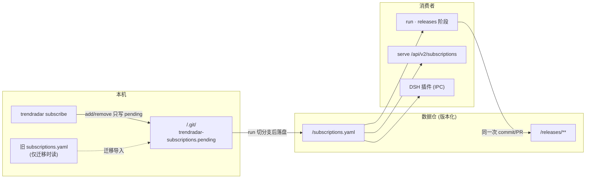
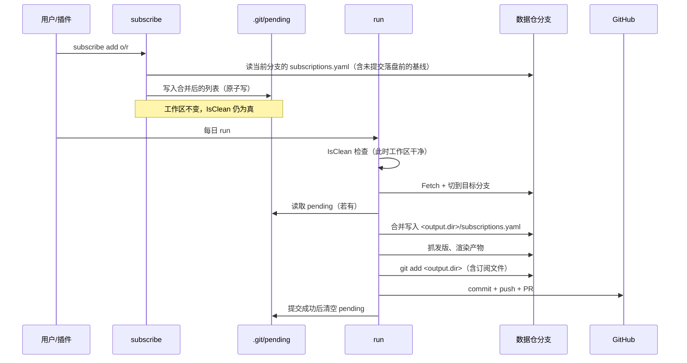

# 订阅数据版本化技术方案（方案 A：订阅随数据仓）

> 状态：已实施 ｜ 实施：P1–P5 完成 ｜ 作者：DSH Agent ｜ 评审人：morehao ｜ 拍板人：morehao ｜ 最后更新：2026-10-31

> 落点：B（既有系统 `trendradar` 的新增子系统）+ C（既有 `internal/subscription` 的行为变更）。主场景：S4 替换与迁移（存储位置从本机迁到数据仓）。档位：标准档。用途：构建契约。
> 相关：整体架构见 [architecture.md](../architecture.md)（§5 数据与存储）；前置能力见 [发版订阅方案](2026-10-31-repo-release-watch-design.md) 与 [contract v0.3.0 方案](2026-10-31-contract-releases-v3-design.md)。
>
> 一句话：把订阅列表从「本机 `subscriptions.yaml` + `.example` 模板 + gitignore」改为**数据仓内受版本控制的文件**，订阅的增删走分支 + PR，`run` 从数据仓读取；`serve` 和插件看到的仍是同一份数据，但不再依赖某一台机器的本地文件。

## 背景与目标

### 业务背景与现状

订阅功能（v0.5.0）当前把列表放在本机文件里：

| 事实 | 证据锚点 |
|---|---|
| 订阅文件路径由 `--file` → `releases.subscriptionsFile` → `./subscriptions.yaml` 解析，相对 **config 文件目录** | `internal/subscription/subscription.go:55-79` |
| 文件被 `.gitignore` 排除，只有 `subscriptions.example.yaml` 进库 | `.gitignore:17`、`subscriptions.example.yaml` |
| `run` 从该路径加载订阅 | `cmd/trendradar/run.go`（`buildReleasesOptions` → `subscription.Load`） |
| `serve` 只读地暴露订阅列表 | `internal/serve/releases.go:111-124`、`handleListSubscriptions` |
| 插件可经 IPC 增删订阅 | `cmd/trendradar/subscribe_ipc.go` |
| 数据仓从 `run` 有一次提交/PR 的全流程 | `internal/app/run.go:307-460`（`IsClean` → `Fetch` → 切分支 → 写盘 → `AddAll` → `Commit` → `Push` → PR） |
| `IsClean` 忽略未跟踪文件 | `internal/gitx/git.go:25-31`（`status --untracked-files=no`） |
| `AddAll` 只 stage `outDir` | `internal/app/run.go:413` |

**需求来源**：用户确认订阅会有外部消费者（DSH 插件、未来 Web 页面），并选择方案 A「订阅随数据仓版本化」。

### 痛点分析

1. **换机即失忆**：订阅只在某台机器的某个文件里；新机器没有本地文件 → `run` 的 releases 阶段静默跳过（只打 warning，见 `smoke` 行为），表现为「不报错但不再有发版摘要」。
2. **团队不可共享**：数据仓（产物）是共享的，订阅却不是；两个人跑同一数据仓，看到的发版内容取决于各自本地文件。
3. **变更无审计**：`subscribe add` 直接改本地文件，没有 review、没有历史；出了问题无法追溯「谁在什么时候加了哪个仓库」。
4. **示例文件误导**：`subscriptions.example.yaml` 内含 `morehao/trendradar` 等真实仓库名，照抄即订阅他人仓库。

### 目标与非目标

**业务目标**：订阅成为**数据仓里的一份受版本控制的资产**——可 review、可回溯、跨机一致；插件与 Web 看到的订阅始终与 `run` 使用的完全一致。

**技术目标（可衡量）**：

- G1 单一来源：`run`、`serve`、IPC `subscribe list` 三处读取**同一个文件**；口径：三者对同一数据仓返回的列表逐项相同。
- G2 可审计：订阅增删最终**随一次产物提交**进入 git 历史（不额外开 PR），提交信息含本次订阅变更明细。
- G3 幂等：重复执行同一 `subscribe add` 不产生新提交（口径：第二次运行 `git log` 数量不变）。
- G4 迁移无损：旧本地文件的订阅在首次运行被**合并**进数据仓，不丢失（口径：迁移后列表 ⊇ 旧列表）。
- G5 兼容：未配置 `releases.enabled` 的部署行为不变；旧的 `--file` 仍可用于只读排查。
- G6 不脏工作区：`subscribe` 任何操作后 `git status --porcelain --untracked-files=no` 仍为空（这是本方案能成立的前提）。

**收益口径**：消除「换机后静默不产出」这一整类故障（当前无告警，靠人发现）；订阅变更从「不可追溯」变为「每次一条 commit」（假设：订阅变更频率 ≤ 5 次/周，即每周 ≤ 5 条提交，对数据仓历史压力可忽略）。

**非目标（超出范畴的用例）**：

- 不做订阅的 Web 写接口（`POST`）——写仍走 CLI / IPC，避免在无鉴权的 serve 上开写入口。
- 不做订阅分组/标签/每仓参数覆盖——本期仍是扁平的 `owner/repo` 列表。
- 不改发版产物的读取路径：`serve` 的订阅接口**签名不变**，只改数据来源。
- 不迁移历史：只有「当前列表」需要迁，历史订阅状态由 git 历史天然保留。

**反目标（做成了也算失败）**：

- 若订阅写入导致 `run` 的**产物提交**被拆分或产生重复 PR——即使订阅功能正确也算失败。
- 若数据仓里同时存在两份订阅文件（本地 + 仓内）且 `run` 读错——算失败。
- 若迁移时把旧列表**覆盖**掉数据仓已有列表——算失败。

### 假设与约束

- `[假设]` **订阅文件位于数据仓内 `<output.dir>/subscriptions.yaml`**（默认 `digests/subscriptions.yaml`）。理由：落在 `run` 已 stage 的 `outDir` 内，无需改 staging 逻辑（`internal/app/run.go:413`）；且与产物同级，review 时一处可见。
- `[假设]` **订阅变更落在 `.git/` 下的 pending 副本，不碰工作区**。`subscribe add/remove` 只写 `<repo>/.git/trendradar-subscriptions.pending`；`run` 在**切到目标分支之后**才把 pending 合并进工作区文件并纳入本次提交。理由：`run` 的 `IsClean`（`internal/gitx/git.go:25-31`）会让**已被跟踪文件**的任何修改判脏并直接 `REPO_DIRTY`（`internal/app/run.go:307-313`，已实测），因此订阅变更**绝不能提前落在工作区**；而 `.git/` 下的文件不参与 `git status`（已实测）。
- `[假设]` **订阅提交与产物提交共用一次 commit/PR**，但**提交判定独立于产物**。理由：现有 `unchanged := filesMatch(files, …)` 只看渲染产物（`internal/app/run.go:401`、`filesMatch` 468-480），若订阅变更不参与该判定，产物没变的那次 run 会整段跳过写盘与 commit（`run.go:402-416`），订阅改动被静默丢弃。方案把订阅文件纳入「待提交集」并让 `HasStagedChanges` 独立决定是否 commit。
- `[假设]` **迁移策略为合并**：目标分支上无订阅文件时，若 pending 或旧本机文件存在则导入；都存在时取并集并给 warning。
- 硬约束：`internal/subscription` 的**既有** `Load/List/Add/Remove/Save` 语义保留（仍是「读写某个具体文件」），新增路径解析与 pending 层作为**新函数**，不复用旧签名承载 repo 语义（旧 `ResolveSubscriptionsPath` 只保留给 `--file` 与本机兼容路径）。契约不变（订阅仍是 `string[]`）。
- 宿主约束：数据仓 `main` 受保护，写操作走分支 + PR；`run` 的 `IsClean` 忽略未跟踪文件但**不忽略已跟踪文件的修改**。

### 验收标准

| 目标 | 验证方式 | 阈值 | 谁验 |
|---|---|---|---|
| G1 单一来源 | 三处（run/serve/IPC list）分别读同一仓 | 列表逐项相同 | 开发者 |
| G2 可审计 | 执行 add → 跑 `run` → 查 git log | commit 数与产物提交一致，正文含订阅变更 | 开发者 |
| G3 幂等 | 同一 add 连跑两次 + 两次 `run` | 第二次无新 commit | 开发者 |
| G4 迁移无损 | 仅本地有旧文件 → 首次 run | 数据仓文件出现且 ⊇ 旧列表 | 开发者 |
| G5 兼容 | 未启用 releases 的配置跑 run | 产物与 v0.5.0 一致，不写订阅 | 开发者 |
| G6 不脏工作区 | `subscribe add` 后查 `git status` | 输出为空 | 开发者 |

## 方案设计

### 系统上下文与边界

- **本系统**：`internal/subscription`（路径解析与写入）、`cmd/trendradar`（`subscribe` 子命令与 IPC）、`internal/app`（`run` 读取订阅并随产物提交）、`internal/serve`（只读暴露）。
- **上游**：用户（CLI）、插件（IPC）、GitHub 数据仓（受保护分支 + PR）。
- **下游**：`releasewatch`（消费订阅列表）、Web 页面（经 serve）。
- **数据所有权**：订阅列表由**数据仓**拥有（版本化）；本机只保留一个可选的旧文件用于迁移。
- **对既有模块的影响**：`serve` 的订阅接口返回结构不变；`run` 增加「写订阅文件」的 stage 内动作；`subscribe` 不再写 CWD 附近的文件。

### 总体思路

订阅文件最终以**数据仓里的一个文件**存在，但**写入不经过工作区**：

1. **读取**：`run` / `serve` / `subscribe list` 都从 `<repo>/<output.dir>/subscriptions.yaml` 读（切到目标分支后）。文件不存在时视为空列表，并尝试从 pending 或旧本机文件迁移。
2. **写入（关键）**：`subscribe add/remove` 只写 `<repo>/.git/trendradar-subscriptions.pending`。这个位置**不参与 `git status`**，所以 `IsClean` 不受影响，`run` 不会被 `REPO_DIRTY` 挡住。
3. **落盘与提交**：`run` 在 `IsClean` 检查通过、切到目标分支之后，才把 pending 合并进工作区的订阅文件，随后与产物一起 `git add` / commit / PR。提交后清空 pending。
4. **提交判定独立**：订阅文件被显式并入待提交集，`HasStagedChanges` 决定是否 commit——避免「只有订阅变化」被 `filesMatch` 跳过。
5. **迁移**：目标分支无订阅文件时，从 pending 或旧本机文件合并导入。

一句话：**订阅的「意图」在 `.git/` 里排队，订阅的「事实」在分支上落定。**

### 总体架构



图中要点：`subscribe` 与 `run` 之间靠 `.git/` 里的 pending 交接，工作区全程不被 `subscribe` 弄脏。

### 核心流程



### 备选方案与取舍

| 备选 | 做法 | 优点 | 代价 / 不选原因 |
|---|---|---|---|
| **A（选中）pending 副本 + run 代提交** | `subscribe` 写 `<repo>/.git/*.pending`；`run` 切分支后落入工作区、随产物同一次 commit | 不弄脏工作区（绕开 `IsClean`）；一份数据；一处 review | 订阅变更要等下一次 `run` 才入库 |
| B 直接改工作区文件 | `subscribe` 写 `<output.dir>/subscriptions.yaml` | 实现最直接 | **跑不通**：文件首次提交后变 tracked，第二次 `add` 即令 `IsClean` 判脏 → `run` 抛 `REPO_DIRTY`（已实测） |
| C 订阅独立分支 + 独立提交 | `subscribe` 自行 commit/push 到 `subscriptions` 分支 | 即时生效、与产物解耦 | 两套 PR/合并流程；`subscribe` 要处理网络、冲突、鉴权，运维成本最高 |
| D 保持本地文件（v0.5.0 现状） | `.example` + gitignore | 零改动 | 换机即失忆、不可审计，与用户诉求直接冲突 |

选择 A 的判据：B 被 `IsClean` 的事实约束直接否决（这是本方案第一版的设计错误）；C 的「即时生效」收益抵不过维护一条独立发布流水线的成本。A 用 `.git/` 这个天然不污染工作区的位置，换取「订阅进数据仓」的全部收益。

### 技术选型与理由

- **订阅文件落 `<output.dir>/subscriptions.yaml`，写入经 `.git/` pending 中转**（选中）。Why：文件在 `outDir` 内才能被既有 `g.AddAll(ctx, outDir)`（`internal/app/run.go:413`）自动纳入提交；pending 中转避开 `IsClean`。代价：订阅与产物同一 PR；变更延迟 ≤1 个调度周期。何时不该选：要求秒级生效时走备选 C。
- **提交判定独立于产物**（选中）。Why：`filesMatch` 只看渲染产物，若沿用会丢弃「只有订阅变化」的提交。代价：`run` 需要把订阅文件显式并入待提交集并单独判 `HasStagedChanges`。何时不该选：若订阅永远与产物同频变化（不成立，订阅是低频人工操作）。
- **迁移用合并语义**（选中）。Why：G4 要求不丢数据。代价：首次迁移可能得到并集；提供 `--reset` 供显式覆盖（见开放问题）。
- **`serve` 接入点**：保持 HTTP 接口与响应结构不变，但**必须改 wiring** 从 `cfg.Repo.Path + outputDir` 推导（当前 `cmd/trendradar/serve.go` 按 config 目录解析，与 run 不同源）。这是承认的接入点变更，不是「零改动」。

### 决策与需求对照

| 决策 ID | 决策 | 承接需求 | 备选（含不做） | 验证手段 | 状态 |
|---|---|---|---|---|---|
| F1 | 订阅文件放 `<output.dir>/subscriptions.yaml` | R1、G1 | 仓根 / 独立分支 / 保持本地 | 文件位于 outDir 内且被 `AddAll` 覆盖 | Proposed |
| F2 | `subscribe` 写 `.git/trendradar-subscriptions.pending`，不碰工作区 | R2、G3、G6 | 直接写工作区（跑不通）/ 立即 commit | 写后 `IsClean` 仍为真 | Proposed |
| F3 | `run` 切分支后把 pending 并入工作区，随产物同一次 commit/PR | R2、G2（不额外开 PR） | 独立 PR | `git log` 一条，含订阅变更 | Proposed |
| F4 | 提交判定独立于产物：订阅文件并入待提交集，`HasStagedChanges` 决定 | R3、G3 | 沿用 `filesMatch`（会丢提交） | 仅订阅变化时仍产生 commit | Proposed |
| F5 | 首次迁移从 pending/旧本机文件**合并**导入 | R4 | 覆盖 / 不迁移 | 迁移后列表 ⊇ 旧列表 | Proposed |
| F6 | `serve` 改 wiring 从 `cfg.Repo.Path+outputDir` 读，HTTP 结构不变 | R5、G1 | 保持 config 目录解析（不同源） | 三处列表一致 | Proposed |
| F7 | 订阅路径若被配置到 outDir 之外则拒绝启动 | R1 | 允许并静默漏提交 | 配置校验 | Proposed |
| F8 | 旧 `--file` 仅作只读临时覆盖 | R6 | 移除 | 指定时 add/remove 返回 CONFIG_INVALID | Proposed |

> 需求编号：R1 订阅文件进数据仓受版本控制；R2 订阅变更可审计且幂等；R3 不产生重复提交/PR；R4 旧本地订阅无损迁移；R5 所有消费者读同一份数据；R6 保留临时覆盖能力。

## 详细设计

### 模块划分与职责

| 模块 | 新增/改动 | 职责 |
|---|---|---|
| `internal/subscription` | 改 | 新增 `RepoPath()` 解析、`Merge()`、`ImportFrom()`；`Save` 保持原子写 |
| `internal/config` | 改 | `releases.subscriptionsFile` 语义改为「数据仓内相对路径」，默认 `subscriptions.yaml` |
| `internal/app` | 改 | `run` 从数据仓加载订阅；提交信息加入订阅变更摘要 |
| `cmd/trendradar` | 改 | `subscribe` 写数据仓工作区；`--file` 退化为临时覆盖 |
| `internal/serve` | 改 | 订阅路径从 `cfg.Repo.Path + outputDir` 推导 |
| `contract` | **不改** | 订阅仍是 `string[]` |

### 接口设计

**路径（`internal/subscription`）**

```go
// RepoSubscriptionsPath: <repoPath>/<OutputRoot(outputDir)>/<file>，绝对路径。
//
// outputDir 在这里**内部按 render.OutputRoot 归一**——这是唯一真源。调用方
// （run / serve / subscribe）一律传原始 cfg.Output.Dir，不要在外部各自归一：
// cfg.Output.Dir 默认为空字符串，而 render.OutputRoot("")=="digests"，
// 两边归一不一致会导致 run 读 <repo>/digests/... 而 serve 读 <repo>/...（仓根），
// G1「三处同源」直接破产（已实测）。
//
// 同时校验 file 必须是归一后 outDir 内的相对路径（不允许绝对路径或 .. 逃逸），
// 否则 AddAll(outDir) 覆盖不到它，订阅变更会静默漏提交。
func RepoSubscriptionsPath(repoPath, outputDir, file string) (string, error)

// PendingPath: <repoPath>/.git/trendradar-subscriptions.pending（本机暂存）。
func PendingPath(repoPath string) string
```

> `ResolveSubscriptionsPath`（旧）**只保留给 `--file` 与本机兼容路径**，不再承担数据仓语义。
> 这一点是对既有 API 的**语义收窄**，不是「零改动」——实现时旧函数注释要写明。

**读写**

```go
// RunBranchName 用与 app.Run 完全相同的规则推导「某天的目标分支名」：
//   <BranchPrefix|"trending/"> + <period> + "/" + render.NameOf(period, date)
// 见 internal/app/run.go:331-335、internal/render/period.go:66。唯一真源，
// 禁止 subscribe / serve 各自拼分支名。
func RunBranchName(branchPrefix, period, date string) string

// ReadRepoOnTargetBranch 读**目标分支**上的订阅文件（不是当前 checkout 的分支）。
//
// 目标分支必须确定性推导，**禁止回落到「当前 checkout 分支」**：run 落盘到的是
// 日期相关分支（RunBranchName），而 subscribe 在 run 之外执行；若读当前分支，
// 当用户在 main、而某 date 分支已有更新订阅时会读到 stale 基线（上一轮评审
// 已确认是隐患）。签名因此必须能拿到 period / branchPrefix / date（取自 config + today）。
//
// 该分支不存在（当日尚未首次 run）时视为空 Store，不报错。
func ReadRepoOnTargetBranch(repoPath, outputDir, file, branch string) (*Store, error)

// WritePending 把 repos 原子写入 pending（不碰工作区）。
func WritePending(repoPath string, repos []string) error

// ReadPending 读 pending；不存在返回 (nil, false)。
func ReadPending(repoPath string) ([]string, bool, error)

// ClearPending 在 **commit + push 都成功**之后删除 pending。
// 任何失败都不清，保证下次 run 可以重放（宁可重复一次 commit，不可丢订阅）。
func ClearPending(repoPath string) error

// MergeUnique 返回 a ∪ b 且保持 a 的顺序，附带 added 计数。
func MergeUnique(a, b []string) (merged []string, added int)
```

**`subscribe` 的行为**

| 命令 | 读 | 写 | 备注 |
|---|---|---|---|
| `list` | 目标分支文件；不存在则 pending | 否 | pending 非空时提示「尚未提交」 |
| `add` | 目标分支文件 ∪ pending | pending | 只写 pending，工作区不变 |
| `remove` | 目标分支文件 ∪ pending | pending | 同上 |

`--file` 显式指定：`list` 可用（只读该文件），`add/remove` 返回 `CONFIG_INVALID`。

**`run` 的接入点（`internal/app`）**

顺序很关键，必须与 `IsClean` 的相对位置正确：

```
1. (cmd 层) 读出 pending、RepoSubscriptionsPath、分支文件的合并基线
2. app.Run: g.IsClean() ── 此时工作区干净（订阅只在 .git 里）
3. g.Fetch → 切/建目标分支
4. 读目标分支上的 subscriptions.yaml，与 pending 合并
5. 合并结果非空且与分支文件不同 → 写入工作区文件，加入待提交集
6. 渲染产物（沿用现有逻辑）
7. 待提交集 = files(产物) + [订阅文件(若有变更)]
8. 写盘 → g.AddAll(outDir) → HasStagedChanges → Commit
9. Push（pushWithRetry）成功后才 ClearPending
```

**提交判定（修正既有 `unchanged` 逻辑）**

现有：`unchanged := filesMatch(files, …)`，为真则整段跳过写盘与提交。
改为：

```
artifactsUnchanged := filesMatch(artifacts, repoPath)
subscriptionsDirty := 订阅文件在本次 run 中被写入且字节与分支版本不同
if !artifactsUnchanged || subscriptionsDirty {
    write artifacts
    write subscriptions (if dirty)
    g.AddAll(outDir)
}
changed, _ := g.HasStagedChanges()   // 只有真的 staged 了才 commit
```

这样「只有订阅变化」也能产生一次 commit（修掉评审 blocker #2）。

**`serve` 的接入点（`cmd/trendradar/serve.go`）**

```go
// 现在（不同源：按 config 目录解析）：
subsPath = ResolveSubscriptionsPath(cfgPath, cfg.Releases.SubscriptionsFile)
// 改为（与 run 同源；注意传**原始** cfg.Output.Dir，由函数内部 OutputRoot 归一）：
subsPath = RepoSubscriptionsPath(cfg.Repo.Path, cfg.Output.Dir, cfg.Releases.SubscriptionsFile)
// 同时 serve 的 digests root 也应统一用 render.OutputRoot(cfg.Output.Dir)，
// 否则 serve 的 /api/v2/releases* 与订阅接口会指向不同目录。
```

HTTP 接口与响应结构不变；这是**接入点变更**，需在 PR 里显式说明。

### 数据模型

无数据库。订阅文件格式不变（`schema: 1` + `subscriptions: []`），新增一个本机暂存层：

| 实体 | 载体 | 键 | 生命周期 | 是否入库 |
|---|---|---|---|---|
| SubscriptionList | `<repo>/<output.dir>/subscriptions.yaml` | `owner/repo` | git 历史托管 | 是（随 PR） |
| PendingSubscriptions | `<repo>/.git/trendradar-subscriptions.pending` | — | 提交成功后删除 | 否 |
| LegacySubscriptionList | 旧本机 `subscriptions.yaml` | `owner/repo` | 迁移后不再读 | 否 |

三者的优先级：**分支文件是事实，pending 是待落地的意图，legacy 只在两边都空时兜底导入。**

### 关键逻辑与算法

**1）`subscribe add`（不碰工作区）**

```
branch = RunBranchName(cfg.Output.BranchPrefix, cfg.Releases.Period, today)  # 与 run 同一规则
base   = ReadRepoOnTargetBranch(repoPath, cfg.Output.Dir, file, branch)      # 读该分支，不用当前 checkout
pend   = ReadPending(repoPath)                    # 可能有
cur    = base ∪ pend                              # 用户在 CLI 看到的「当前」
next, added = MergeUnique(cur, newRepos)           # 校验 + 去重
if added > 0: WritePending(repoPath, next)        # 只写 .git
return added
```

**2）`run` 落盘与提交（顺序是关键）**

```
g.IsClean()                  # 必须在此之前不对工作区做任何写
g.Fetch(); 切/建分支
base   = ReadRepoOnTargetBranch(repoPath, outputDir, file, branch)   # 已切到 branch
pend, hasPend = ReadPending(...)
merged, added = MergeUnique(base, pend)           # 迁移也是这条路径
subsDirty = hasPend && merged != base

artifactsUnchanged = filesMatch(artifacts, repoPath)
if !artifactsUnchanged || subsDirty:
    writeArtifacts(...)
    if subsDirty: writeSubscriptions(merged)
    g.AddAll(outDir)                              # 订阅文件在 outDir 内，自动覆盖
changed, _ = g.HasStagedChanges()
if changed:
    Commit(...)
    pushWithRetry(...)          # 必须 push 成功
    ClearPending()              # push 之后才清：commit 成功但 push 失败时保留 pending 重放
```

**3）幂等（修正后）**

- 订阅文件**不进 `render.Comparable`**（它不是渲染产物，没有 `generatedAt` 之类易变字段）；
  判等就是文件字节比较。
- **提交判定不能只靠 `filesMatch`**：产物没变但订阅变了时，`subsDirty=true` 会触发写盘与
  `AddAll`，再由 `HasStagedChanges` 决定是否 commit。
- 重复的 `subscribe add` 是幂等的：`MergeUnique` 不增加条目 → pending 不变 → 下次 run
  时 `subsDirty=false` → 无新 commit。
- **pending 只在 push 成功后清空**：若 commit 成功而 push 失败（或后续 PR 被 close 且分支
  被删），pending 仍在，下次 run 重放一次。副作用是极端情况下可能重复一次 commit——
  **宁可重复，不可丢失**。

**4）为什么不能用「直接写工作区」**

实测（`git status --porcelain --untracked-files=no`）：

- 文件**未跟踪**时：工作区对 `IsClean` 仍显示干净 → 首次看似可行；
- 文件**已被跟踪**后（第一次提交之后）：任何修改都显示 ` M digests/subscriptions.yaml`
  → `IsClean` 返回 false → `run` 抛 `REPO_DIRTY`（`internal/app/run.go:307-313`）。

即「直接写工作区」从第二个周期起必定失败。这就是选 pending 模型的直接原因。

**5）迁移与 `--reset`**

- 两边都空 → 空列表，正常。
- 只有 pending/legacy → 直接用。
- 分支有 A、pending 有 B → A∪B 并给一次 warning（不静默覆盖）。
- 用户显式要覆盖时 `subscribe add --reset`（见开放问题 Q2）。

## 验证与验收

### 验证手段

- 单元测试：`RepoSubscriptionsPath`（含 outDir 逃逸拒绝）；`MergeUnique`；`ReadRepo/WritePending/ClearPending` 组合（有/无分支文件 × 有/无 pending）。
- **关键用例（针对评审 blocker）**：
  - 「subscribe add 后 `git status` 仍干净」——证明 pending 不污染工作区；
  - 「产物未变、只有订阅变」→ 仍产生 1 条 commit——证明提交判定修正生效；
  - 「同一 add 连跑两次 + 两次 run」→ 第二次无新 commit（幂等）。
- 集成测试：临时 git 仓 + fake fetcher，跑「add → run → 再 add → 再 run」两个周期，断言第二周期不被 `REPO_DIRTY` 拒绝。
- 回归：未启用 releases 时产物与 v0.5.0 字节一致；`serve` 三接口响应结构不变。
- 迁移测试：分支无文件 + 本地旧文件 → 首次 run 后仓内文件出现且 ⊇ 旧列表。

### 关键假设与证伪实验

| 假设 | 证伪实验 | 若不成立 |
|---|---|---|
| `.git/` 下文件不影响 `git status` | 写 pending 后跑 `git status --porcelain --untracked-files=all` | 换暂存位置（如 OS 临时目录 + 显式路径） |
| 已跟踪文件的修改会让 `IsClean` 判脏（故必须用 pending） | 改 tracked 文件后跑 `status --untracked-files=no` | 若实测为干净，则可简化回直接写工作区 |
| 订阅文件在 `outDir` 内能被 `AddAll(outDir)` 覆盖 | 单测：写文件后 `git add -A -- <outDir>` | 显式 add 订阅文件 |
| 合并语义不会让列表无序膨胀 | 连续 3 次迁移 | 加 `--reset` 覆盖选项 |

### 观察指标与判据

- `run --json` 的 `releases.repos` 数量应与数据仓订阅文件条数一致（不一致即告警）。
- 订阅导入发生时记 warning 一次，便于确认迁移完成。

## 实施计划

| 里程碑 | 内容 | 完成判据 |
|---|---|---|
| P1 路径与暂存 | `RepoSubscriptionsPath`（含逃逸校验）+ pending 读写 + 单测 | 单测覆盖各组合 |
| P2 写入改造 | `subscribe` 写 pending；`--file` 只读；`list` 提示未提交 | CLI 测试 + 「add 后工作区仍干净」 |
| P3 run 集成 | 落盘顺序、提交判定修正、`ClearPending`、`--dry-run` 只读 | 「只有订阅变也产生 commit」+ 两周期不被拒 |
| P4 serve 对齐 | wiring 改从 `cfg.Repo.Path+outputDir` 推导 | 三处列表一致 |
| P5 迁移与文档 | 迁移合并、warning、README/AGENTS 更新 | 手工迁移一次 |

### 时间估算

| 里程碑 | 估算 |
|---|---|
| P1 路径与读取 | 0.5–1 人日 |
| P2 写入改造 | 0.5 人日 |
| P3 run 集成 | 1 人日 |
| P4 serve 对齐 | 0.5 人日 |
| P5 迁移与文档 | 0.5 人日 |
| **合计** | **3–3.5 人日** |

## 风险评估与应对

### 技术风险

| 风险 | 触发条件 | 动作 |
|---|---|---|
| 订阅变更丢失 | commit 成功但 push 失败，pending 被提前清 | **ClearPending 放在 push 成功之后**；任何失败都保留 pending，下次 run 重放（可能重复一次 commit，但不会丢） |
| 用户手动删 pending | 误操作 | 订阅仍在分支文件里；只丢失尚未提交的增删，`subscribe list` 会提示 |
| 订阅文件被配到 outDir 之外 | 配置 `subscriptionsFile: ../x.yaml` | `RepoSubscriptionsPath` 校验拒绝启动（F7） |
| `output.dir` 变更后订阅「消失」 | 用户改配置 | 首次在新路径找不到 → 提示迁移；旧文件仍在旧路径可手搬 |
| 并发两次 `subscribe` 写 pending | 同时开两个终端 | `Save` 原子写 + 读改写；冲突以最后一次为准（订阅是低频操作，可接受） |

### 业务风险

- **变更延迟**：订阅变更要等下个 `run` 才入库。对日更场景可接受；如需即时，用备选 C（代价是独立发布流水线）。
- **示例文件误导**：迁移后 `subscriptions.example.yaml` 应改为空模板或删除。

### 技术债

- 数据仓与本地双路径并存期（迁移窗口）内，需保证 `run` 永不写本地文件。
- `stages/enrich` 仍未进契约（与本方案无关，沿用既有债）。

### 方案沉默清单

1. **数据仓是只读克隆**：`subscribe add` 写 pending 在 `.git/` 内，通常可写；若连 `.git` 都不可写 → 返回明确错误，不静默。
2. **`output.dir` 无法指向仓根**：`render.OutputRoot` 对 `""`/`"."`/绝对路径/`..` 一律回退 `"digests"`（`internal/render/files.go:60-66`），故不存在「AddAll 用 `.` 覆盖全仓」的情况；反而要在配置校验里禁止订阅文件逃出 outDir。
3. **首次运行同时存在分支列表与 pending 不同**：取并集 + warning（不覆盖）。
4. **订阅文件（分支上）被手改成非法 YAML**：fail-fast 并指出路径，不静默回落。
5. **pending 里含有分支上没有的仓库**：正常场景（用户刚 add），不是脏数据。
6. **`run --dry-run`**：**不写** pending 到工作区、不提交、不清 pending；只读地展示合并结果。
7. **subscribe 时目标日期分支还不存在**（当天首次 run 前）：视为空基线，pending 即全部内容；首次 run 把它建出来。
8. **跨机：某 date 分支从旧 base 分叉**，他人后来并回 main 的订阅不会自动进入该 date 分支——per-date + 合并语义的固有边界，靠下一次新日期分支收敛。

## 待确认与开放问题

| 编号 | 问题 | 默认倾向 | 拍板人 |
|---|---|---|---|
| Q1 | 订阅变更是否必须独立 PR | 否，随产物提交（备选 C 才独立） | morehao |
| Q2 | 是否需要 `subscribe add --reset` 覆盖迁移 | 先不做，观察一个迭代 | morehao |
| Q3 | 旧 `subscriptions.example.yaml` 保留还是删除 | 改为空模板保留（去掉真实仓库名） | morehao |
| Q4 | 订阅文件是否允许配到 outDir 之外 | 不允许，校验拒绝 | morehao |
| Q5 | `serve` 是否本期一并改 wiring | 是，否则 G1 不成立 | morehao |

## 已知未覆盖

- 订阅的 Web 写接口与鉴权（本期只读）。
- 订阅分组 / 每仓覆盖参数。
- 多订阅文件（按分组拆分）。
- 订阅变更的即时生效（不等 `run`）。
