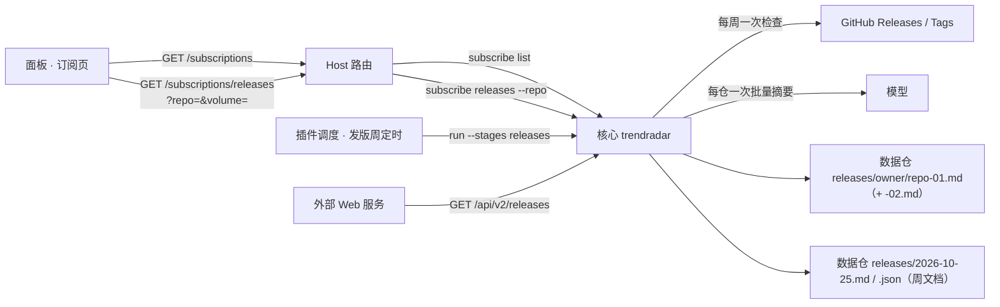

# 订阅页与发版记录设计

> 状态：已实施 ｜ 实施版本：核心 0.7.0 / 契约 0.4.0 / 插件 0.6.0 ｜ 作者：AI（morehao 审阅） ｜ 评审人：morehao ｜ 拍板人：morehao ｜ 最后更新：2026-11-01

> 返回：[架构设计](../architecture.md)。实施记录见文末「实现与方案的差异」。本文件是 `docs/specs/` 下的唯一版本，`.dsh/docs/` 下的同名草稿不再维护。

## 背景与目标

### 现状与问题

订阅页现在只是「列表 + 添加面板」，没有搜索、排序、批量，也没有任何每仓信息：

- 页面实现：[subscriptions.ts](client/subscriptions.ts#L83-L133) 把 `owner/repo` 平铺成两列行，唯一操作是逐行移除；空态只有一句「还没有订阅任何仓库」。
- 数据面：`GET /subscriptions` 只返回 `{ repos: string[] }`（[routes.ts](src/host/routes.ts#L231-L237)），核心 `subscribe list` 也只回仓库名。
- 发版摘要：核心把 changelog 写进数据仓 `<output.dir>/releases/`，每周/每期一份；面板的预览机制明确排除了 `releases/` 前缀（[runner.ts](src/host/runner.ts#L479-L487)），运行记录页只有汇总数字（[runs.ts](client/runs.ts#L281-L300)）。
- 结果：订阅到 40 个仓库后，找某个仓库订没订只能靠肉眼扫；改了什么要回数据仓或 PR 看；批量退订只能一个个点。

### 目标与非目标

**业务目标**

- 40 个订阅时，定位「这个仓库订没订」≤ 2 次交互（输入或扫视一屏）。
- 面板内可直接读到 100% 的发版总结（当前为 0）；读者不需要离开面板去数据仓。
- 批量退订 20 个仓库 ≤ 3 次点击（进入选择、全选匹配、确认移除）。
- 发版检查的定时可配置（周几 + HH:MM + 时区），触发延迟 ≤ 60 s；错过时刻 6 h 内补跑一次。
- 每次发版运行都能在面板里查到（保留最近 30 条）。

**技术目标**

- 列表首屏请求体 ≤ 10 KB（口径：40 个仓库、`items[]` 含 6 个字段的 JSON UTF-8 字节数）。
- 抽屉打开到可读 ≤ 300 ms P95（口径：本地 IPC + 单文件读取，不含用户点击延迟；10 次采样）。
- 每周每仓最多 1 次模型调用（口径：有变化的仓库数；当前按每个新 tag 一次，40 仓、平均 1.5 个新 tag/周时约 60 次/周）。

**非目标（超出范畴的用例）**

- 跨仓库的「本周所有变化」聚合页：需要另一套时间线视图，本期不做。
- owner 维度分组/索引：`owner/repo` 是唯一标识，owner 只作为字符串前缀，不单独成维度。
- 每仓备注、标签、星数：Host 与核心都没有对应字段，也不该由插件另行抓取。
- 批量添加：用户明确不需要；添加只有命令栏一个入口。
- HTTP 面内置鉴权/限流：面向单机本地用户，不做；跨机部署由使用方加反向代理承担。

**反目标（做成了也算失败）**

- 面板显示的摘要与数据仓文档不一致（面板二次总结、改写、拼接顺序不同）。
- 为了信息量把首屏拖到 2 屏以上或列表 payload 超过 10 KB。
- 同一 ISO 周被追加两次，文档出现重复章节。
- 某一周的记录因为切卷判断而丢失，或被拆到两册。

### 假设与约束

- [假设] 订阅规模 ≤ 100 个仓库；单仓单周新增 tag ≤ 10 个。超过 10 个时文档里只列前 10 个，其余写成「其余 N 个」。
- [假设] 数据仓的 `<output.dir>` 为单一目录，`releases/` 是唯一发版产物目录。
- 硬约束：插件不写用户仓库（只经核心 IPC 增删订阅）；`state.json` 等仍由 `src/state.ts` 独占写入；契约类型只来自 npm 包 `@morehao/trendradar-contract`；客户端产物只允许 `require('react')`。
- 硬约束：核心的 HTTP 面（`GET /api/v2/releases` 等）不只服务插件，可能被独立 Web 服务消费，**本次不下线、不改既有字段语义**。
- 前提：核心 HTTP 面只在本机使用（默认 `127.0.0.1`），不内置鉴权与限流；这是已确认的部署形态，不是待定项。
- 排期：单期完成；无并行人手。

### 验收标准

| 编号 | 验收项 | 怎么验 | 阈值 |
|---|---|---|---|
| A1 | 列表信息完整 | 40 仓 fixture 下检查表头与行字段 | 每行有仓库、最近版本、最近总结、状态、变更入口 |
| A2 | 首屏体积 | 抓 `/subscriptions` 响应字节数 | ≤ 10 KB（40 仓） |
| A3 | 抽屉可读 | 点「变更」到文档渲染完成，10 次采样 | P95 ≤ 300 ms |
| A4 | 周幂等 | 同一 ISO 周连续跑两次 | 文档章节数不变，文件哈希不变 |
| A5 | 无变化不写 | 一周内无新 tag 的仓库连跑两次 | 文档 mtime 与内容不变 |
| A6 | 卷切分边界 | 构造 599 行的当前册，写入一段 20 行的周章节；再跑一周 | 第一次写入完整落在第 1 册（619 行，不拆节）；第二次才生成 `-02.md` 并写入新章节 |
| A7 | 单一来源 | 面板抽屉文本与数据仓文档做 diff | 逐字一致（允许首尾空白差异） |
| A8 | 异常可见 | 模拟 GitHub 限流 / 模型失败 | 行状态显示「限流 / 失败」，抽屉顶部提示本周未更新 |
| A9 | 外部 API 不破 | 旧版 `GET /api/v2/releases` 消费方跑契约 fixture | 字段与语义保持，新增字段可忽略 |
| A10 | IPC/HTTP 同源同形 | 同一 fixture 下分别调 IPC 与 HTTP | `items[]` / `SubscriptionDoc` 逐字段一致（传输层包一层信封除外） |
| A11 | 发版定时 | 配周三 09:15，观察 60 s tick；模拟停机跨过时刻 | 60 s 内触发；6 h 内补跑一次；同一 ISO 周不重复 |
| A12 | 发版运行记录 | 跑一次发版任务 | 新增 1 条记录（status、checked、changed、newTags、failed、duration、tokens），运行记录页可见，保留 30 条 |
| A13 | 并发自适应 | N=40 / N=100 各跑一次 | 传给核心的 concurrency 为 4 / 8；budget 为 150 s / 300 s |
| A14 | 不碰订阅文件 | 发版运行前后对 `subscriptions.yaml` 取哈希 | 哈希不变（pending 不合并） |

## 总体设计

### 上下文与边界



边界：面板只读；写路径全部在核心（周文档 + 每仓文档）。插件新增两件事——列表透传每仓字段、按仓取文档内容。

### 设计思路

1. **列表轻、文档按需**：列表只承载判断所需的最小信息（最近 tag、最近总结日期、状态）；完整总结放抽屉，打开时按仓取一次。
2. **周粒度、批量总结**：核心每周一次，把一个仓库这一周新增的全部 tag/Release 合并成一次模型调用、一段总结；不再逐 tag 总结。
3. **一仓一份文档、按周追加**：`releases/<owner>/<repo>-01.md` 是这份仓库的发版记录，最新一周在最上面；超过行数阈值另起 `-02.md`，面板按卷读取。
4. **面板 = 文档的渲染**：抽屉不重新组织内容，直接把文档 markdown 渲染出来，保证「看到的就是仓库里那份」。
5. **外部 API 保留**：周文档（ReleaseDigest JSON/MD）继续生成并保留 `GET /api/v2/releases`，供独立 Web 服务消费；每仓文档是并列的人类可读物，不是替代品。

### 备选与取舍

| 备选 | 做法 | 为什么没选 / 什么时候该选 |
|---|---|---|
| **不做（维持现状）** | 列表 + 添加面板，摘要只落数据仓 | 不做的代价：40 个订阅下找仓库靠扫、看变化要出面板；痛点已被用户确认，故不选 |
| **A 列表塞全量历史** | `subscribe list` 直接带回每仓全部周总结 | payload 随历史线性增长（40 仓 × 52 周 ≈ 2000 段），首屏超过 10 KB 一个数量级；只在订阅 < 5 仓时成立 |
| **B 按 tag 逐条总结 + 每期一份周文档** | 每个新 tag 一次模型调用，文档按周分文件 | 模型调用次数随 tag 数放大；面板要跨多个文件拼接；没有「一仓一份」的可读产物 |
| **C 周批量 + 一仓一份文档 + 列表轻量（选定）** | 每周一次批量总结，追加到仓库文档，面板按需读 | 满足 A2/A3/A7；代价是文档需要卷切分与幂等控制 |
| **D 只保留 JSON、面板渲染结构化数据** | 每仓一份 JSON，面板画列表 | 人不可读、PR 不可评审；且与「一个文档看完」的用户诉求相反 |

### 技术选型

| 决策点 | 选择 | 备选 | 理由与代价 |
|---|---|---|---|
| 发版记录的存储形态 | 数据仓里的 markdown | 核心本地 SQLite / JSON sidecar | markdown 可读、可 diff、随 PR 评审；代价是写入要处理卷切分与手工编辑冲突 |
| 面板取文档的方式 | 核心返回整份 markdown，面板用现有渲染器渲染 | 核心返回结构化 sections，面板自绘 | 保证面板与文件逐字一致（A7），实现最少；代价是标签链接、样式受 markdown 渲染器能力限制 |
| 卷切分依据 | 行数阈值（默认 600 行） | 按时间（每年一卷） | 行数与文件体积、渲染耗时直接相关，便于给阈值；代价是不同仓库切卷时间不一致 |
| 周闸门位置 | 核心（ISO 周去重） | 插件调度（cron 每周一） | 调度仍是一天一次，核心掌握「这周有没有总结过」的事实；代价是每天多一次空跑判断（毫秒级） |
| IPC 与 HTTP 的关系 | 同一能力两个门面：只读都镜像，写只走 IPC | HTTP 随用随加；HTTP 独立 DTO | 独立 Web 服务只依赖 HTTP，面板只依赖 IPC，两者共用契约类型；代价是每个新读接口要写两遍路由（薄封装） |

### 决策与需求对照表

| ID | 决策 | 承接需求 | 备选（含不做） | 验证手段 | 状态 | 置信度 |
|---|---|---|---|---|---|---|
| D1 | 列表只带每仓摘要字段，按需拉文档 | A1 / A2 | A 列表塞全量；不做 | 响应体积断言 | Accepted | 高 |
| D2 | 每周一次批量总结 | 技术目标 3 | B 按 tag 逐条 | 调用次数日志 | Accepted | 高 |
| D3 | 一仓一份 markdown，按周 prepend | A7 / 反目标 1 | D 纯 JSON | 抽屉与文档 diff | Accepted | 高 |
| D4 | 写入前超过 600 行才另起 `-02.md`（阈值已定为 600） | A6 | 按年切卷；不切分 | 构造超长文档的用例 | Accepted | 中 |
| D5 | 抽屉用 markdown 渲染器渲染文档 | A7 | 结构化 sections 自绘 | 文本 diff | Accepted | 高 |
| D6 | 保留 ReleaseDigest 与 `/api/v2/releases` | A9 / 硬约束 | 下线只留每仓文档 | 旧 fixture 回归 | Accepted | 高 |
| D7 | 升级前的历史不回填 | 已知未覆盖 1 | 解析旧 `releases/*.md` 回填 | 无（范围外） | Accepted | 中 |
| D8 | 添加入口只有命令栏 | 用户明确要求 | 批量添加弹层 | 交互走查 | Accepted | 高 |
| D9 | 切卷只在写入前判断，本次写入必完整 | A6 / 反目标 4 | 写入中按需拆节；拒绝写入 | 599→619 行用例 | Accepted | 高 |
| D10 | IPC 的只读能力都有 HTTP 镜像，写操作不暴露 | A10 / 硬约束 | HTTP 只保留旧接口；另造一套 DTO | IPC/HTTP 逐字段对拍 | Accepted | 高 |
| D11 | HTTP 面不内置鉴权/限流 | 单机本地用户 | 内置 token/限流 | 部署形态走查 | Accepted | 高 |
| D12 | 周阶段并发按订阅量自动 | A13 | 固定 4；固定 8 | 断言传给核心的配置 | Accepted | 高 |
| D13 | 发版检查独立定时 + 6 h 补跑 | A11 | 跟随日报时间；只靠核心周闸门 | 触发日志 | Accepted | 高 |
| D14 | 每次发版运行落一条记录（上限 30） | A12 | 复用历史记录；不记录 | `releaseRuns` 断言 | Accepted | 高 |
| D15 | 发版运行复用当日分支/PR，不合并 pending | A14 | 独立分支直达主线；合并 pending | 文件哈希 + PR 检查 | Accepted | 中 |
| D16 | 补跑窗口 6 h，超窗跳过本次 | A11 | 单独配 24 h；无限补跑 | 模拟停机用例 | Accepted | 高 |
| D17 | 摘要上限默认 1200 字符（可配 500–2000） | 技术目标 3 | 按 tag 各写一段；不设上限 | 超长 notes 用例 | Accepted | 中 |

## 数据与契约

### 实体与生命周期

| 实体 | 关键字段 | 生命周期 |
|---|---|---|
| 订阅项 SubscriptionItem | `fullName`、`latestTag`、`latestSummaryAt`、`lastCheckedAt`、`status` | 随订阅存在；每次周检查更新 |
| 仓库文档 RepoDoc | 卷号、路径、行数、最近更新、起止周 | 首次总结创建；每周 prepend；超阈值开新卷 |
| 周章节 WeekSection | `weekStart`、`weekEnd`、`tags[]`、`summaryZh`、`degraded` | 每周一条；幂等，不可重复 |
| 周文档 ReleaseDigest（既有） | `date`、`period=weekly`、`repos[]`（含每仓 `summaryZh`） | 供 HTTP API 与外部 Web 服务；与每仓文档同源同次生成 |
| 发版运行记录 ReleaseRun | `id`、`startedAt`、`finishedAt`、`status`、`checked`、`changed`、`newTags`、`summarized`、`degraded`、`failed`、`rateLimited`、`tokens`、`durationMs`、`commit`、`prUrl`、`error` | 每次发版运行一条；保留最近 30 条 |

状态机（订阅项）：`baseline`（首次只记基线）→ `ok`（本周有总结）｜`no_change`（本周无新版本）→ `rate_limited` / `failed`（检查失败，保留旧游标，下周重试）。

### 仓库文档格式

```md
# vercel/next.js

> 发版记录 · 每周一次 · 最近更新 2026-10-25

## 2026-10-19 ~ 2026-10-25

- [v15.2.0](https://github.com/vercel/next.js/releases/tag/v15.2.0) · 10-22
- [v15.1.9](https://github.com/vercel/next.js/releases/tag/v15.1.9) · 10-20

这一周发了 v15.2.0 与 v15.1.9 两个版本：构建缓存命中率提升，修复 App Router 下动态段预渲染的几处回归……
```

- 每册都带两位序号：第 N 册是 `releases/<owner>/<repo>-0N.md`（`-01`、`-02`…）。第 1 册也有 `-01`，这样「某仓库的全部卷」是一个稳定的通配，首册不会看起来像未切卷的另一份文档。
- 新的一周 prepend 到「当前册」的标题行之后。**切卷判据只看写入前**：写入前当前册行数 `L` ≤ `maxLines`（默认 600）时，本次章节**完整写入当前册**，即使写完后超过 `maxLines`；只有下一次写入时（`L > maxLines`）才新开一册。新册首行写 `# owner/repo`，第二行写指向前一册的链接。
- 这条规则保证：任何一节都不会被拆到两册，也不会因为「这次会超」而丢掉本周记录；极端情况下单节本身超过 `maxLines`，仍整节写入当前册，下一周再开新册。
- 幂等：当前册里已存在同一 `weekStart ~ weekEnd` 的二级标题时直接跳过，不追加。
- 原子写：临时文件 + rename，权限沿用现有产物（0600 由插件侧负责的仅限 `state.json`，数据仓文件随 git 默认权限）。

### 契约变更（`@morehao/trendradar-contract` 0.4.0）

```jsonc
// 1) SubscriptionList（GET /subscriptions、subscribe list）
{
  "repos": ["vercel/next.js"],            // 保留：旧消费者唯一依赖
  "items": [{                              // 新增，可选
    "fullName": "vercel/next.js",
    "url": "https://github.com/vercel/next.js",
    "latestTag": "v15.2.0",
    "latestSummaryAt": "2026-10-25",       // 最近一节的周末；表里的「最近总结」
    "lastCheckedAt": "2026-10-26T00:00:00Z",
    "status": "ok"                         // ok | no_change | baseline | rate_limited | failed
  }]
}

// 2) SubscriptionDoc（subscribe releases --repo o/r [--volume N]）
{
  "fullName": "vercel/next.js",
  "volume": 1,
  "volumes": [{ "index": 1, "file": "next.js-01.md", "from": "2026-03-02", "to": "2026-10-25", "lines": 412 }],
  "updatedAt": "2026-10-25",
  "markdown": "# vercel/next.js\n\n> 发版记录 ……"
}
```

- `ReleaseDigest` 保留并加可选字段：`repos[].summaryZh`（周批量总结）、`repos[].periodStart/periodEnd`；`releases[].summaryZh` 改为可选并停用（旧文档仍可读）。
- `RunRequest` 增可选 `stages: ('trending'|'digest'|'releases')[]`，缺省全开；发版运行只传 `['releases']`。
- `ReleasesReport` 在现有聚合字段上增 `checked`（检查了多少仓）与 `changed`（有变化的仓），供运行记录展示；`details[]` 可选。
- 调度（周几/几点/时区）是插件侧概念，**不进核心 YAML**；`releases.schedule` 只存在 `settings.json`。
- 兼容：旧插件忽略 `items`；新插件在旧核心（无 `items`）时降级为只有仓库名、无「变更」入口。

### IPC 与 HTTP 的对应关系

| IPC 能力 | HTTP 路由 | 状态 |
|---|---|---|
| `subscribe list` | `GET /api/v2/subscriptions`（追加 `items[]`） | 已有路径，追加字段 |
| `subscribe releases --repo` | `GET /api/v2/repos/{owner}/{repo}/releases?volume=N` | 新增 |
| `run` 的周文档 | `GET /api/v2/releases`、`GET /api/v2/releases/{date}` | 不变 |
| `subscribe add/remove` | 不暴露 | 写操作只经插件 IPC |

**镜像判据**（新命令进 PR 前必须回答）：

1. 只读且外部消费者需要 → 必须有 HTTP 路由，且与 IPC 共用同一个契约类型，不另造 DTO。
2. 写操作 → 默认不暴露；要暴露必须单独设计鉴权、审计与限流，不在本版范围。
3. 每个新增 IPC 命令的 PR 里写一句「HTTP 对应路由 / 为何不需要」，作为评审检查项；A10 的逐字段对拍是机械兜底。
4. 上面这张映射表随契约包 README 维护，新增命令与路由同步改表，避免两份能力清单各自漂移。

HTTP 面仍只读、`no-store`、不返回密钥；`serve` 默认绑 `127.0.0.1`，跨机部署由使用方自行加反向代理与鉴权。

## 实现要点

### 核心改动（trendradar）

1. **周闸门**：每个仓库记录最近一次总结的 ISO 周键（`2026-W43`，只用于去重，不用于文件名）。同一周再次运行时跳过该仓：不请求 GitHub、不调模型、不改文档。判定使用配置时区（默认 Asia/Shanghai），跨年周按 ISO 8601。插件侧的周定时负责「什么时候跑」，核心闸门负责「同一周跑两次也只写一次」，两者是双保险。
2. **增量收集**：从上次游标之后取该仓库的全部 Release / Tag（`perRepoLimit` 不再限制抓取条数，只限制文档里列出的 tag 数，超出写「其余 N 个」）。
3. **批量总结**：每个有变化的仓库一次模型调用，输入是这一批 tag 的 notes（合计受 `maxNotesChars` 约束），输出一段 `summaryZh`；失败时降级为拼接原文并标记 `degraded`。
4. **周文档**：继续生成 `releases/<周末日期>.md` 与 `.json`（如 `2026-10-25.md`，`period: weekly`；`ReleaseDigest` schema 升 2：仓库级 `summaryZh` + `periodStart/periodEnd`），文件名仍用日期，保持 `GET /api/v2/releases/{date}` 的既有语义可用；这是外部 Web 服务的数据面。
5. **每仓文档**：用同一段 `summaryZh` 渲染周章节并 prepend 到当前册；执行卷切分、幂等检查、原子写。
6. **订阅接口**：`subscribe list` 的 `items[]` 由订阅 YAML + release 缓存 + 文档索引拼出；新增 `subscribe releases --repo o/r [--volume N]`，读当前册返回 markdown 与卷索引。读路径限制在 `<repo>/<output.dir>/releases/` 内，拒绝 `..` 与符号链接逃逸。
7. **配置**：`releases.weekStart`（默认 `monday`）、`releases.docMaxLines`（默认 600）、`releases.summaryMaxChars`（默认 1200）。`period` 语义改为「总结周期」，本版只支持 `weekly`，其他值报 `CONFIG_INVALID`。
8. **独立发版运行**：`run --stages releases` 只做发版阶段——不渲染 trending/digest、不合并 pending 订阅、只读 `subscriptions.yaml`；产物仍走现有 commit/PR 流程（复用当日分支/PR，没有则新建 `releases/<date>`），避免与日报运行抢同一个 `subscriptions.yaml`。
9. **并发自适应**：`releases.concurrency: auto` 解析为 `clamp(4, ceil(checked / 10), 8)`；`releases.budgetSeconds: auto` 解析为 `min(300, 30 + 3 × checked)`。显式数字仍可覆盖。
10. **HTTP 镜像**：`serve` 补 `GET /api/v2/subscriptions`（带 `items`，若既有路由已存在则追加字段）与 `GET /api/v2/repos/{owner}/{repo}/releases?volume=N`；响应体与 IPC 共用契约类型，只多一层传输信封。非法 repo 形状、越界卷号、缺失文档分别返回 400/404。
11. **测试**：假核心覆盖 list/releases/周闸门/卷切分/幂等/降级/stages 过滤；HTTP 路由与 IPC 用同一 fixture 对拍（A10）；真核心的 `GET /api/v2/releases` 用契约 fixture 回归。

### 插件改动

| 层 | 改动 |
|---|---|
| `src/host/routes.ts` | `/subscriptions` 返回 `{ repos, items }`；新增 `/subscriptions/releases?repo=&volume=`（校验 repo 形状与卷号） |
| `src/host/subscribe.ts` | list 透传 `items`；新增 releases 命令封装（超时 30 s、错误码映射为 `SUBSCRIBE_FAILED`） |
| `client/api.ts` | `getSubscriptions()` 返回 items；新增 `getSubscriptionDoc(repo, volume?)` |
| `client/subscriptions.ts` | 按原型 C 重写：命令栏（查/加）、四列表格、表头排序、批量选择、队列条、文档抽屉、空态/加载/失败 |
| `client/styles.ts` | 新增 `.dshgt-subs-*` 类，全部走 `--gt-*` 令牌 |
| `src/host/schedule.ts` | 增加发版周调度：周几 + HH:MM + 时区、60 s tick、错过 6 h 内补跑（超窗则跳过，下周把两周增量一起总结）、同一 ISO 周不重复；与日报运行共用单运行锁 |
| `src/host/runner.ts` | 新增 `runReleases()` 入口（`stages: ['releases']`），复用取消/单运行锁/记录写入 |
| `src/config.ts` | 新增 `releases.schedule{enabled,weekday,time,timezone}`（插件侧字段，**不进核心 YAML**）、`releases.concurrency:'auto'|number`、`releases.budgetSeconds:'auto'|number`（`auto` 在 `toCoreConfig` 时按本次 checked 解析成数字再写 YAML） |
| `src/state.ts` | 新增 `releaseRuns[]`（上限 30，原子写 0600），`/state` 返回 |
| `client/settings.ts` | 发版订阅分区加「定时（周几/时间/时区）」与「并发（自动/指定）」 |
| `client/runs.ts` | 运行记录加类型筛选（全部 / 日报 / 发版），发版记录展示 checked/changed/newTags/failed/tokens |
| `client/subscriptions.ts` | meta 行显示「上次发版检查 10-26 08:00 · 下次 11-02 08:00」（来自 releaseRuns 与调度配置） |
| `client/i18n.ts` | 新键：列名、五种状态、meta、批量条、抽屉标题/卷切换/失败提示、键盘提示、发版运行类型与字段；zh/en 同键同占位符 |

抽屉内卷切换：`volumes.length > 1` 时在头部显示 `第 N 册 / 共 M 册` 与上一册/下一册按钮；切换时按 `volume` 再取一次文档（不进缓存，保证与文件一致）。

### 页面结构（定稿）

- 页头：标题 + 一句话说明 + 「选择」。
- 命令栏：46 px，输入即筛选；输入完整 `owner/repo` 出现添加建议，回车添加。
- meta：`40 个仓库 · 每周一次（周一 08:00，可在设置里改）· 下次 11-02 08:00` ／ `上周 10-19 ~ 10-25 · 7 个仓库有变化`；发版任务有记录后追加「上次发版检查 10-26 08:00」。
- 表格：仓库（280）/ 最近版本（130）/ 最近总结（100）/ 状态（110）/ 行操作（116，常驻「变更」+ hover「移除」）。
- 抽屉：460 px，仓库名 + 文档（周章节、tag 链接、总结段落）+ 卷切换 + 写入位置说明。
- 选择模式：首列复选框，底部条「已选 N / 全选匹配 / 取消 / 移除所选」，确认框列出前 6 个。

## 容量与成本

| 项 | 估算 | 口径与假设 |
|---|---|---|
| 单仓文档行数 | ≈ 470 行/年 | 52 周 × 约 9 行/节（标题 1 + tag 2–3 + 总结 3–4 + 空行） |
| 切卷频率 | 约 15 个月/次 | 600 行阈值 ÷ 470 行/年；按每周都有变化的上限估算 |
| 列表 payload | ≈ 5 KB | 40 仓 × 约 120 B/项（JSON UTF-8） |
| 抽屉 payload | ≤ 24 KB | 600 行 × 约 40 B/行；HTTP 同一份文档同样是 ≤ 24 KB（不含 gzip） |
| 模型调用 | ≤ 40 次/周 | 40 仓、每仓每至多 1 次；无变化不调用 |
| 现状对照 | 约 60 次/周 | 40 仓 × 1.5 个新 tag/周，按每 tag 一次估算 [假设] |
| 周阶段耗时 | 30–60 s | N=40 时并发 4、单次 3–6 s [假设] |
| 并发公式 | 4 / 8 | `clamp(4, ceil(N / 10), 8)`：N=40 → 4；N=100 → 8 |
| 预算公式 | 150 s / 300 s | `min(300, 30 + 3 × N)`：N=40 → 150；N=100 → 300 |

## 风险与应对

| 风险 | 触发条件 | 应对 |
|---|---|---|
| 同一周重复追加 | 手动运行与定时重叠 | 核心按 ISO 周闸门 + 文档章节幂等；重复时跳过并记日志 |
| 模型失败/超时 | 供应商 5xx 或超时 | 降级为原文拼接，章节标注「降级」；状态记 `failed`，下周重试不丢数据 |
| GitHub 限流 | 403 rate limit | 保留旧游标、状态 `rate_limited`；不写半节文档 |
| 文档被手工编辑 | 用户改标题或删章节 | 写入前校验首行 `# owner/repo`，不匹配则以错误结束本次该仓、不覆盖文件 |
| 卷切换后读错册 | 面板缓存了旧卷号 | 每次打开抽屉按当前卷索引取，切换时重新请求；不缓存跨周 |
| 路径逃逸 | repo 名含 `..`/斜杠 | 只接受 `^[A-Za-z0-9_.-]+/[A-Za-z0-9_.-]+$`，并校验解析后的路径在 `releases/` 内 |
| 外部 API 消费方受影响 | schema 升 2 | 只加字段不改旧字段；发布前用契约 fixture 回归 `GET /api/v2/releases` |

## 实施计划

| 阶段 | 内容 | 完成判据 |
|---|---|---|
| 1 | 契约 0.4.0：`SubscriptionList.items`、`SubscriptionDoc`、`ReleaseDigest` schema 2（加字段） | 契约包测试通过，fixtures 更新 |
| 2 | 核心：周闸门、批量总结、周文档、每仓文档与卷切分、`subscribe list/releases`、HTTP 镜像 | 假核心 + 单测覆盖 A4/A5/A6/A9/A10 |
| 2.5 | 核心：`stages=releases` 与并发自适应 | 发版运行只写发版产物，A13/A14 通过 |
| 3 | 插件 host：路由、命令封装、发版调度与 `releaseRuns` 记录 | `/subscriptions`、`/subscriptions/releases`、调度触发与记录断言 |
| 4 | 插件 client：页面重写、抽屉、i18n、样式 | 界面走查 + `npm run check` |
| 5 | 文档与截图更新 | README / docs 同步，原型目录留档 |

## 方案沉默清单

- 同一分钟内的重复运行（定时 + 手动）——闸门 + 幂等兜住，但日志要能看出来。
- 仓库被改名或删除（404）——状态记 `failed`，文档不动，下周重试；不自动退订。
- 单周 tag 超过 10 个——文档只列前 10 个，其余写「其余 N 个」，总结仍覆盖全部。
- 模型输出超长——按 `summaryMaxChars` 截断，截断处加省略号并在日志记一次。
- 文档被外部工具改写（格式化、排序）——首行校验失败即放弃本仓写入，不动用户内容。
- ISO 周边界（周日 23:59 / 周一 00:00）——按配置时区计算周键，跨年周用 ISO 8601 的 `2026-W01`。
- 首次订阅（baseline）——只记基线，不写空章节；状态 `baseline`。
- `output.dir` 变更——旧文档留在旧目录（不在本次范围），新文档写新目录；面板按当前配置读取。
- 发版时刻遇到夏令时或时区规则变化——按 IANA 时区算术判定，落库用带偏移的 ISO 时间。
- 补跑与手动触发撞车——单运行锁 + 同一 ISO 周去重，后到的直接跳过并记日志。
- `releaseRuns` 超过 30 条——淘汰最旧记录，不影响文档与订阅数据。

## 已知未覆盖

1. 升级前的历史不回填：旧 `releases/*.md` 保留给外部 API，但不解析成每仓文档；每仓文档从升级后第一周开始积累。
2. 不做跨仓库聚合视图（「本周所有仓库的变化」）。
3. 不做批量添加。
4. 不做文档的删除/归档 UI；卷只增不减。

## 决议记录

原「开放问题」三项已于 2026-11-01 收口，落到决策表：

- 发版运行的分支/PR 复用规则 → D15（Accepted，置信度中；实现时以核心现有分支解析为准）。
- 补跑窗口 → D16：6 h，超窗跳过本次，下周把两周增量一起总结，不丢数据。
- 摘要长度 → D17：默认 1200 字符，可配 500–2000，超长截断并记日志。

## 附录：原型与截图

原型与逐项目录：`.dsh/docs/prototypes/2026-10-31-subscriptions-redesign/`（`directions.md` 记录了六个候选、页面结构与交互清单）。关键截图：

- `dir-C.png`：列表（命令栏 + 四列 + 常驻「变更」）。
- `state-C-drawer.png`：抽屉 = 该仓的发版记录文档。
- `state-C-drawer2.png`：检查失败时「本周未更新」的提示。
- `state-C-queue.png`：移除后的队列条与撤销。
- `state-C-emptyall.png`：零订阅空态。

## 实现与方案的差异

实施过程中发现三处「按方案做会破坏既有不变量」，按仓库实际约定做了调整，其余按方案落地。

| 项 | 方案写法 | 实际实现 | 为什么 |
|---|---|---|---|
| 周文档路径 | `releases/<周末日期>.md` | 沿用既有「周期目录/桶/ISO周」结构，周期目录改成 `releases/_weekly/<年>/<ISO周>.md` | `GET /api/v2/releases/{date}` 的 date→文件名映射由 `render.NameOf` 决定，改命名会让历史文档失联（A9）；只把周期目录加下划线前缀，既避开与 owner 同名目录的冲突，读取又同时兼容旧的 `releases/weekly/`。日期语义没变：`date` 仍是周末（period end），路由照旧可用 |
| 发版运行分支 | 复用当日分支/PR，没有则 `releases/<date>` | 沿用 `subscription.RunBranchName(prefix, releases.period, date)` → `trending/weekly/<ISO周>` | 分支名必须与 `subscribe` / `serve` 读取订阅文件的分支**同源**（AGENTS §10 单一来源）。用 `releases/` 前缀会让 `subscribe list` 读到另一个分支，订阅状态与文档分叉。同一 ISO 周内重跑自然复用同一分支与 PR |
| 失败与周闸门 | 失败也记「本周已检查」 | 只有成功（含 `no_change` / `baseline`）才写 `weekKey`；失败只写 `status`/`lastCheckedAt` | 失败没有推进游标，同周内显式重试是安全的、也更符合「失败可重试」。跨周不丢数据由「游标没动 → 下周一起总结」保证 |

补充：

- 卷名统一为 `<repo>-NN.md`（第 1 册也是 `-01`）：用户确认「release 相关的按仓库命名」，且每册都带序号比「首册裸名 + 续册带号」更一致。`SubscriptionVolume.file` 与抽屉里的路径说明随之统一。
- 周汇总目录改成 `releases/_weekly/`（原 `releases/weekly/`）：`releases/` 顶层同时放「每仓目录」和「聚合周期目录」，owner 恰好叫 `weekly` 时两者会挤进同一个目录。加下划线前缀后新写入不再冲突；读取仍先看 `_weekly/` 再看旧的 `weekly/`，所以升级不会让历史周文档从 `GET /api/v2/releases*` 里消失，索引与清单按周去重。
- 每仓文档的周章节里列出的版本数由 `releases.perRepoLimit` 决定（默认 10），**抓取与总结不受该值限制**；超出部分写「其余 N 个」。
- 插件侧对 `@morehao/trendradar-contract` 的依赖在 0.4.0 发布前先用本地类型声明（`src/ipc.ts`，带注释），发布后再切回包导入——契约包发布需要用户确认，不在本期内自动执行。
- HTTP 面新增 `GET /api/v2/repos/{owner}/{repo}/releases?volume=N`，与 IPC `subscribe releases` 共用 `releasedoc.Read`，A10 的「逐字段一致」由同一个函数保证。
- 插件侧 `releases.schedule.timezone` 同时决定「发版运行用哪一天」与核心的 `releases.timezone`，让运行日期、文档的 ISO 周边界与 `lastReleaseWeek` 三者一致（否则跨时区时三者会各算一天）。
- 插件对发版调度加了「同一 ISO 周 + 同一本地日期最多 2 次尝试、间隔 ≥ 5 分钟」的重试上限：补跑窗口有 6 h，没有上限时一个持续失败的发版任务会每 60 s 拉起一次核心。
- 页面按原型 C 实现，但**没有做「移除后的队列条 / 撤销上一步」**：移除本身就是写入 `.git/…pending` 的即时操作，核心侧没有撤销接口；成功反馈走顶部提示。行操作列用「弹性右对齐 + `min-width:116px`」实现，不额外占一个填充格。批量移除的确认框列出前 6 个并说明剩余数量。
- 没有新增 `POST /run/releases` 手动触发路由：本期的手动入口是 `runner.runReleases`（工具/内部调用），HTTP 面保持只读（D10）。
- 发版运行记录挂在 `/state` 的 `status.releaseRuns`（≤30 条）；订阅页 meta 行的「上次发版检查」读同一个字段。


## 验收对照（A1–A14）

「机械覆盖」= 有自动化用例，改动后可直接重跑；「走查」= 需要真机面板/真实 GitHub 才能判。
本期完成的是实现，发版（tag / npm 发布 / 插件发布）不在范围内。

| 编号 | 状态 | 验证位置 / 说明 |
|---|---|---|
| A1 列表信息完整 | 机械覆盖（数据面）+ 走查 | `internal/serve/subscriptions_test.go` 断言 40 仓 fixture 的五个字段；`client/subscriptions.ts` 渲染四列 + 变更入口 |
| A2 首屏体积 | 机械覆盖 | 契约 `test/contract.test.mjs`：`subscriptions-40.json` ≤ 10 KB（实测约 8 KB） |
| A3 抽屉 P95 ≤ 300 ms | 机械覆盖（IPC 段）+ 走查 | 在 484 行 / 16.8 KB 的仓文档上跑 10 次 `subscribe releases --json`（冷启动预热 3 次）：p50 7.1 ms、p95 7.4 ms、max 7.4 ms；口径是「本地 IPC + 单文件读取」，不含浏览器渲染。浏览器渲染与面板交互仍需真机走查 |
| A4 周幂等 | 机械覆盖 | `TestPlanIsIdempotentForSameWeek`、`TestBuildWeeklyGateSkipsSecondRun`、`TestReleaseOnlyRunIsIdempotentWithinWeek` |
| A5 无变化不写 | 机械覆盖 | 周闸门 + `changed=0` → 无文档文件（`TestReleaseOnlyRunIsIdempotentWithinWeek` 断言无新 commit） |
| A6 卷切分边界 | 机械覆盖 | `TestPlanRollsVolumeOnlyAfterExceedingBudget`（599 行 → 不拆；下一次 → `-02.md`） |
| A7 单一来源 | 机械覆盖 | `subscribe releases` 与 HTTP 都走 `releasedoc.Read`；`TestSubscriptionDocMatchesReadPath` 逐字段相等 |
| A8 异常可见 | 机械覆盖（状态）+ 走查 | `TestBuildFailureIsolated` / `TestBuildRateLimitStopsRemainingRepos` 产出 `failed` / `rate_limited`；抽屉 warn 条由 `client/subscriptions.ts` 渲染 |
| A9 外部 API 不破 | 机械覆盖 | `TestLegacyReleaseDigestStillServed`（schema 1 旧文档仍按原字段返回）、`TestLegacyWeeklyDirStillServed` / `TestWeeklyManifestDedupesAcrossDirs`（旧的 `releases/weekly/` 目录仍可读、与 `_weekly/` 同时存在时清单只列一次） |
| A10 IPC/HTTP 同源同形 | 机械覆盖 | `TestSubscriptionDocMatchesReadPath`、`TestSubscriptionsEndpointCarriesItems`（同一 fixture 下与 IPC 读取函数逐字段一致） |
| A11 发版定时 | 机械覆盖 | `test/schedule.test.mjs`：`isoWeekKey` / `nextReleaseOccurrence` / `isReleaseDue`（6 h 窗口）/ 每周只触发一次 / 超窗不触发 / 失败重试上限 |
| A12 发版运行记录 | 机械覆盖 | `test/runner.test.mjs` 的 `runReleases` 用例 + `test/state.test.mjs`（≤30 条裁剪） |
| A13 并发自适应 | 机械覆盖 | 核心 `internal/config/auto_test.go`（40→4/150、100→8/300）；插件 `test/config.test.mjs` 断言 `toCoreConfig` 解析出的数字 |
| A14 不碰订阅文件 | 机械覆盖 | `TestReleaseOnlyRunLeavesSubscriptionsAlone`（前后 sha256 相同、pending 未被清空） |

未覆盖（本期明确不做）：批量添加、跨仓聚合、升级前历史回填、HTTP 鉴权/限流。
